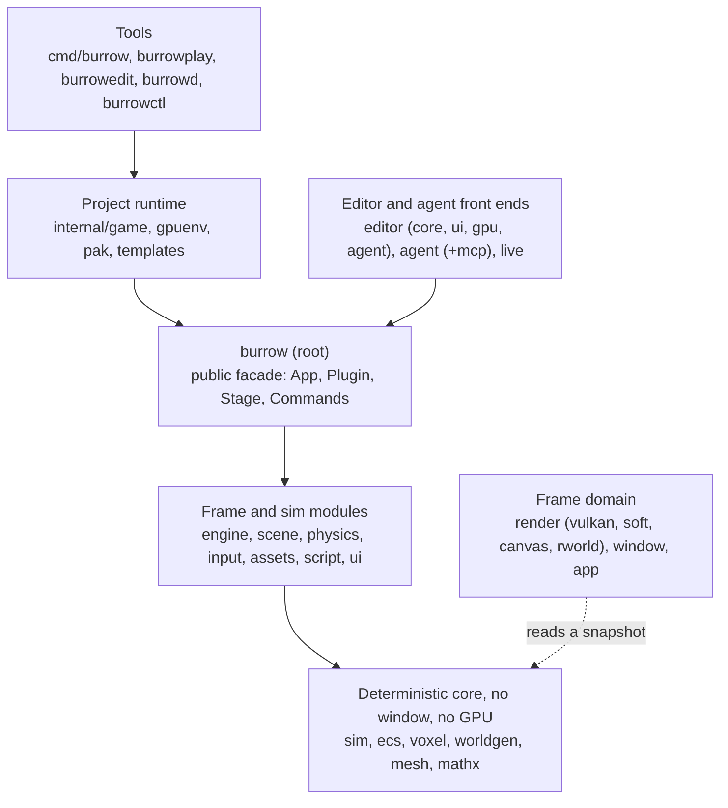
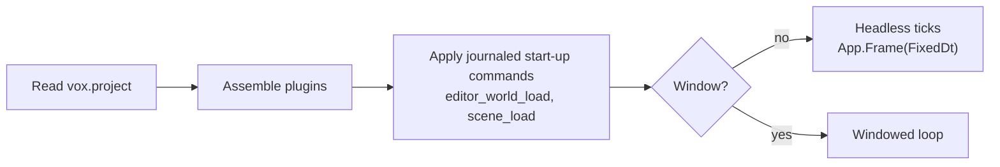

# Architecture and package map

The design rules (two domains, stages, determinism, errors) are in [ARCHITECTURE.md](../ARCHITECTURE.md); this page is the map. Determinism, in one sentence: same project, seed and inputs give the same StateHash, on macOS Apple silicon and Intel (tested). Windows and Linux are checked by the CI workflow against a golden hash, which has not run yet. The simulation uses integer math or explicitly rounded floats with a deterministic math library; rendering is not covered. See [Determinism](determinism.md).

| package | role |
|---|---|
| `burrow` | the stable-ish public API (type aliases and helpers over `engine`, `sim`, `scene`); every exported symbol is documented |
| `engine` | `App`, plugins, stages, resources, events, `Commands`, journal and replay glue, built-in plugins |
| `sim` | fixed-step engine: ECS world, chunk map, block registry, RNG, `Command`s, journal, snapshot, undo, `StateHash` |
| `ecs` | entity-component store, queries, per-type hashing, undo logs |
| `voxel` / `worldgen` / `mesh` | blocks, chunks, raycast and collision / pure terrain generators / greedy mesher |
| `scene` | node tree, transforms, `.voxscn`, prefabs, component schema, scene commands |
| `physics` | AABB bodies, character controller, triggers, queries (FixedUpdate) |
| `input` | actions and bindings (`input.Map` JSON), `State`, `Injector`, recorder |
| `assets` | project manifest (`assets/project`), DB with GUID sidecars, importers, atlas, watcher |
| `script` (+ `gas`, `guestbuild`, `sdk/burrowsdk`) | wazero host, ABI, gas instrumentation, Go guest SDK and builder |
| `render/*`, `window`, `app` | Vulkan and CPU renderers, canvas, scene frame extraction, GLFW window, first-person controller |
| `ui` | immediate-mode toolkit with golden tests on the CPU canvas |
| `editor/core` / `ui` / `gpu` / `agent` | document model, panels, window host, MCP tools |
| `agent`, `agent/mcp` | session API for agents, MCP server |
| `live` | browser viewer hub for watching tests and sessions |
| `internal/game` | loads a project directory or pak and builds the `engine.App` for `burrowplay` and `burrow test` |
| `pak` | `.voxpak` archive and the executable trailer |
| `templates` | embedded `burrow new` templates |

Feature packages added since the first map. Each is a plugin (`runtime.plugins.*`, on unless the project sets it `false`) or a pure library; the ones marked *frame* never touch the `StateHash`.

| package | role |
|---|---|
| `anim` | keyframe clips, players, state machines, voxel skeleton IK ([animation.md](animation.md)) |
| `audio` (`audioplug`, `soundpack`, `audioamb`) | mixer, sound packs, sandbox ambience; *frame* ([audio.md](audio.md)) |
| `particles` (`partplug`) | emitters and effect assets; *frame* ([particles.md](particles.md)) |
| `camera` (`camplug`) | camera rigs, blends, shake; *frame* ([cameras.md](cameras.md)) |
| `gameui` (`uiplug`) | the in-game UI toolkit: `.ui.json` screens, themes, localisation; *frame* ([game-ui.md](game-ui.md)) |
| `level`, `save` (`levelplug`, `saveplug`) | fixed levels and save slots ([levels-saves.md](levels-saves.md)) |
| `character` (`charplay`) | animated player avatar; *frame* ([character.md](character.md)) |
| `nav` | navigation graph, pathfinding, behaviour trees ([navigation-ai.md](navigation-ai.md)) |
| `physics3d` | rigid bodies, joints, voxel bodies, destruction ([physics.md](physics.md)) |
| `fluid`, `weather` | water automaton and the deterministic weather ([water-physics.md](water-physics.md), [weather.md](weather.md)) |
| `blocklogic` | per-cell block data and block events for scripts, project blocks live in `blockset` ([blocks.md](blocks.md#block-logic)) |
| `blockset`, `shape` | the extended block list and non-cubic block shapes ([blocks.md](blocks.md), [block-shapes.md](block-shapes.md)) |
| `itemset` | the project's item registry, stable ids and the 6-byte stack ([items.md](items.md)) |
| `model`, `texedit` | voxel model and pixel-art texture editing ops ([modeling.md](modeling.md)) |
| `docs`, `editor/help`, `docs/docgen` | the embedded documentation, its Markdown engine and search, and the generator of the reference pages ([documentation.md](documentation.md)) |

## A run of `burrowplay`

`internal/game.Build` reads `vox.project`, then assembles plugins in this order: Scene, [Window], Assets (dry-run DB + wasm loader), VoxelWorld
(generator from `runtime`), Input, Physics, Script, [Controller, Render], RenderWorld, extras. It builds the app, applies the journaled start-up commands
(`editor_world_load` for `runtime.world`, `scene_load` for the default scene) and runs headless ticks (`App.Frame(FixedDt)`) or the windowed loop.
Scripts can queue the same journaled `scene_load` at runtime with the `scene_load` host function (`burrowsdk.SceneLoad("scenes/game.voxscn")`,
see `script/ABI.md`): the `.voxscn` file is read pinned by content hash like `asset_read`, so a replay loads the same document — a `default_scene`
can be a menu that hands over to the game scene.
`RenderWorldPlugin` is present even headless so scenes with `render.*` components load and hash identically in both modes.

## Dependencies

`github.com/tetratelabs/wazero` (scripts), `golang.org/x/image` and `golang.org/x/text` (fonts), GLFW bindings and a vendored Vulkan binding (`third_party_vulkan`, MIT fork of goki/vulkan, a package of the engine module itself: import path `burrow-engine/third_party_vulkan`, cgo only). Everything else is the standard library.
