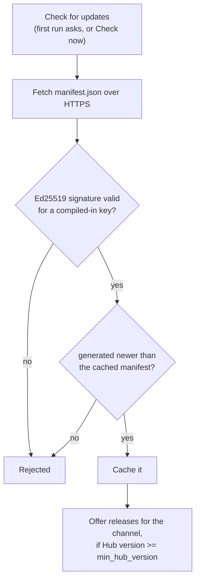

# Burrow Hub

Burrow Hub (`BurrowHub.exe`, `burrowhub`) is the native launcher: it keeps your projects in one list, installs several engine versions side by
side, opens each project with the version it pins, and optionally checks for updates. It is drawn with the engine's own UI toolkit over Vulkan
(no web view). The Hub works fully offline.

```sh
make hub-run          # build and start the Hub (macOS: with the MoltenVK environment)
make hub-test         # vet, gofmt, -race tests, soft screenshots of every panel, one GPU capture per tab
```

## What it does

| tab | content |
|---|---|
| Home | **Play the Sandbox**; continue the last project; a folded **Learn and documentation** section with **Documentation**, **What's new** and **Download** buttons that open the [website](#website-and-news) in your browser, plus the local GETTING-STARTED, docs, examples and templates of the active engine kit); What is new: the signed news and the release notes of the newest release. A **Update available** button next to the tabs jumps to Updates |
| Projects | recent first, pinned on top, search; **New project** (pick a template, a name, a folder and an engine version) and **Import** (a folder explorer with Home / Desktop / Documents / Downloads shortcuts, breadcrumbs and a marker on folders that hold a `vox.project`; the same explorer locates a moved project folder and, behind **Browse...**, picks the location of a new project); per project: **Open in editor** and **Run**, and a **More** menu with Build / Export (`burrow build -o`), Duplicate, Upgrade engine, Show folder, Pin, Remove from list, Delete files. Revert upgrade and the fixes for a broken project stay in the panel |
| Updates | one summary (what is new, one **Update all** button, **Check now**) that installs the newest engine and downloads the new Hub in one job, with progress and cancel. A folded **Advanced** section holds the installed engines (set default, show folder, uninstall, adopt the kit the Hub lives in), the engine releases of the channel with release notes and the update source |
| Settings | automatic check on/off, automatic Hub download on/off (default on with automatic checks; the new Hub replaces the running one at the next start), channel (stable, beta), manifest URL, website URL (editable in developer mode only), new project folder, UI scale (auto or 100 to 300 percent), privacy notes |

A project that cannot be opened shows why and offers a fix: **folder missing** (locate the moved folder or remove the entry), **broken vox.project**
(restore the last upgrade backup), **engine not installed** (install that version when the manifest lists it, or re-pin to an installed one).

"Remove from list" never touches files. "Delete files" is separate, needs a first confirmation, then the project name typed again, and refuses
anything that has no valid `vox.project`.

### Play the Sandbox

The primary button on Home and Templates plays the ready-made `sandbox` template without the editor:

1. No engine installed: the Hub first uses the kit next to it (full installer, nothing contacted). Otherwise it asks before downloading the latest engine from the update source (same signed manifest and sha256 checks as the Updates tab); declining leaves a message and creates nothing.
2. The project is created once as `Sandbox` in the projects folder (Settings; default `BurrowProjects` in your home folder). A later click reuses it and never overwrites or duplicates it; a non-empty folder of that name that is not a Burrow project is left alone and reported.
3. It starts `burrow run <project>` of the project's engine, detached (no console window on Windows).
4. A failure in the first seconds is shown under the button with the tool's own text, for example the "no Vulkan driver" help from the graphics check. Other messages: no engine and download declined, install failed, template missing, could not start.

## Window frame

The Hub window has no system frame: it draws its own title bar (logo, name and version on the left; minimize, maximize/restore and close on the
right, each at least 24 logical px and scaled with the UI scale). Only the Hub does this (`window.Config.Frameless`); the editor and games keep native frames.

- Drag the empty bar to move the window; double-click it to maximize or restore; drag a maximized window off the bar to restore it.
- Resize from any edge or corner (minimum 800x480 logical px). F11 toggles fullscreen and hides the bar. Maximized state and placement are remembered.
- Alt+F4 (and Cmd+W on macOS) closes. The bar buttons are reachable with Tab and have accessible labels (Minimize, Maximize/Restore, Close).
- `BURROW_HUB_FRAME=native` keeps the system frame.

Limits, because GLFW has no native move/resize request: the window follows the cursor frame by frame (slightly less smooth than a native drag);
on Windows the Aero Snap gestures (drag to an edge, snap layouts under the maximize button) are not available, while maximize, restore and
minimize work; diagonal resize cursors are custom images; macOS gets the window shadow through a small Objective-C runtime call; on a native
Wayland session GLFW cannot position windows, so use `BURROW_HUB_FRAME=native` there. The Windows, Linux and Wayland paths are compiled
but have not been tried on a real display.

## Storage

| what | where |
|---|---|
| config (`hub.json`, `projects.json`, `manifest-cache.json`) | `%APPDATA%\Burrow`, `~/Library/Application Support/Burrow`, `~/.config/burrow` |
| engines, downloads, backups, staged Hub updates | `%LOCALAPPDATA%\Burrow`, `~/Library/Application Support/Burrow`, `~/.local/share/burrow` |

`BURROW_HUB_HOME=<dir>` puts both under `<dir>/config` and `<dir>/data` (portable installs, tests). Engines live in `<data>/engines/<version>/` with the layout
of the creator kit zip (`BurrowEditor.exe`, `burrow.exe`, `burrowplay.exe`, `sdk\`, `docs\`, `templates\`, `licences\`, `engine.json`). The kit's own
`engine.json` (`{"version": "..."}`, written by `scripts/dist-engine-windows.sh`) lets the Hub adopt an unpacked kit in place: the first-run
wizard and the Updates tab (Advanced) offer "Use the engine next to this Hub"; for a portable folder nothing is copied and uninstalling only forgets it. A kit that an installer owns (inside
`Burrow.app/Contents/Resources/engine`, an AppImage, the folder of the Windows installer or `install.sh`, a `.deb`: recognised by the app bundle path, `$APPIMAGE`, or an `Uninstall.exe`, `uninstall.sh` or `.managed` file next to the Hub)
is **copied** into the engine store instead, because that folder is replaced when the app is updated and an AppImage is mounted somewhere else on every start (`hub.Store.AdoptCopy`, `hub.KitDirOf`).

### Platforms

The Hub runs on the six desktop targets: Windows, macOS and Linux, each on x64 (`amd64`) and ARM64. Manifest assets are keyed `<GOOS>-<GOARCH>` (`windows-amd64`, `windows-arm64`, `darwin-amd64`, `darwin-arm64`,
`linux-amd64`, `linux-arm64`; `hub.AssetKey`) and a Hub offers only the engine and Hub releases that have an asset for its own key. Release asset names are
`Burrow-Engine-<os>-<arch>` and `Burrow-Hub-<os>-<arch>` with `<os>` = `windows`, `darwin` or `linux` and `<arch>` = `x64`/`x86_64`/`amd64` or `arm64`/`aarch64`; the archive is a **`.zip` on Windows and a
`.tar.gz` on macOS and Linux** (a tarball keeps the exec bits; `burrowrelease manifest` rejects the wrong format, an unknown OS or CPU, and two files for one key). Installers (`BurrowSetup-*.exe`, `*.dmg`,
`*.AppImage`, `.deb`) are not engine assets and are ignored by `burrowrelease manifest`; they are attached to the release as plain files ([Releasing](releasing.md#multi-platform-release)).

The Hub reads the archive format from its content (`PK` or gzip magic), never from the name, and `.tar.gz` gets the same protections as the zip: no absolute path, `..`, drive letter, alternate stream, symlink, hard link,
device or fifo; no duplicate or case-colliding name; entry, per-file and total caps counted while writing; modes reduced to 0644/0755 (no setuid, setgid or sticky bit). Tool names: `BurrowEditor.exe`, `burrow.exe`,
`burrowplay.exe`, `BurrowHub.exe` on Windows, `burrowedit`, `burrow`, `burrowplay`, `burrowhub` elsewhere. Data folders per OS are in the Storage table above.

Hub self-update by layout (`Service.SelfUpdateSupport`): **Windows**, **a Linux install folder you can write** (`install.sh`) and **a macOS app bundle you can write** (`/Applications/Burrow.app` installed by the owner) swap the executable as described below. On macOS the
swap changes the main binary of a sealed bundle, so right after every swap, and after every rollback, the Hub signs the bundle again with the system's `codesign` (ad-hoc, the same three steps as `scripts/pack-macos.sh`: the executable, the bundle with `--deep`, then
`codesign --verify --deep --strict`). If signing or verification fails, the previous executable is put back and signed again, the version is not offered again, and the Updates tab shows the problem. A macOS Hub without `codesign` (no Xcode command line tools) or in a folder the
user cannot write, an **AppImage** (a read-only mounted image) and a folder the user cannot write (a `.deb` in `/opt`) do **not** replace themselves: those Hubs still update the engine versions, and when a newer Hub exists the Updates tab says so and how to get it (new
disk image, new AppImage, `apt`). Nothing is staged, so there is nothing to roll back.

## Engine pins and upgrades

`vox.project` has an `engine` field (`"0.3.0"`, pre-releases such as `"0.4.0-beta.1"` are accepted). It is the version `burrow new` wrote; the Hub
rewrites it. Absent: the Hub uses its default engine, else the newest installed. "Open in editor" starts `<engine>/BurrowEditor.exe -project <dir>`,
Run starts `burrow run`, Build starts `burrow build <dir> -o <file>`, all from the pinned engine's folder with `BURROW_BIN_DIR` and `BURROW_SDK`
pointing at it.

**Upgrade engine** (only to an installed newer version): shows the release notes between the two versions (from the cached signed manifest), writes a
backup zip `<data>/backups/<name>-<version>-<time>.zip`, runs `burrow migrate <dir>` of the target engine when it exists (`"migrate": true` in
its `engine.json`, or `burrow help migrate` answers), then writes the pin. The migration of this engine turns the fine water on for a project that never chose (`runtime.plugins.fine_water` absent; an explicit `false` stays): the water of the project behaves differently, its `StateHash` changes and saves taken with the coarse water do not load, so keep the backup if you need to go back. If migration or the pin fails the project is restored from the backup
automatically. The backup stays registered: **Revert last upgrade** swaps the project folder back (the current folder is kept aside until the swap succeeded).

A project that contains symbolic links is not upgraded (a zip backup cannot restore them faithfully; the message says which one). Restore uses its own lenient
validator for the Hub's backups (file names that are legal on this machine, such as `a:b`, are restored; downloads keep the strict one) and unpacks into a unique temporary
folder next to the project. The state a restore replaces is **kept** as `<project>.before-restore-<time>` until you press "Delete the kept copy"; this includes the failed
state after an automatic restore. Settings has "Keep per project" (default 5): older backups of the same project are pruned after a successful upgrade, never the one Revert needs.

An engine pinned by a listed project cannot be uninstalled. Upgrading never runs the engine on the UI thread: the migration flag comes from `engine.json`; `burrow migrate`
runs in the background job after you confirm.

"Delete files" moves the folder to the trash on macOS and Linux (`gio`), deletes it on Windows, and refuses the home folder, Desktop, Documents, Downloads and the other standard
folders, every folder that contains your home, and drive roots.

Launched tools always get `BURROW_BIN_DIR` of the pinned engine and either its `sdk\` as `BURROW_SDK` or no `BURROW_SDK` at all (an inherited one is removed).

## Updates (no telemetry)

The Hub fetches one signed `manifest.json`. Source, in order: `BURROW_MANIFEST_URL`, `manifest_url` in `hub.json`, the compiled-in default, and finally `<site>manifest.json` when a website is compiled in (see [Website and news](#website-and-news)). The compiled-in
default is a marked placeholder (`https://example.invalid/PLACEHOLDER/...`) that counts as "no update source configured"; the Hub then says so and
does nothing else.

* The first run asks "Check for updates automatically?" and says exactly what a check fetches: `manifest.json` (the release list and the news) from the update host, nothing else. Off means nothing is contacted until you press **Check now**. No request is made before you answer.
* A request carries `User-Agent: BurrowHub/<version> (<os>)` and nothing else: no identifier, no cookie, no body. Proxies follow `HTTPS_PROXY`, `HTTP_PROXY`, `NO_PROXY`.
* HTTPS only, at most 5 redirects, never https to http. `http://127.0.0.1` / `localhost` is accepted only when `BURROW_HUB_ALLOW_INSECURE_LOCAL=1` (tests).
* The last verified manifest is cached, so release notes and the engine list work offline. A manifest whose `generated` time is older than the cached one is
  rejected (replay of an old file).



### Manifest

```json
{
  "schema": 1,
  "generated": "2026-05-01T10:00:00Z",
  "channels": ["beta", "stable"],
  "news": [{"title": "Burrow 0.2.0", "date": "2026-05-01", "summary": "plain text", "link": "https://.../news/index.html#020", "version": "0.2.0", "severity": "info"}],
  "releases": [
    {"version": "0.2.0", "date": "2026-05-01", "channel": "stable", "notes": "markdown", "min_hub_version": "0.1.0",
     "assets": {"windows-amd64": {"url": "https://.../0.2.0/Burrow-Engine-windows-x64.zip", "size": 123456, "sha256": "<64 hex>"}}},
    {"version": "0.2.0", "kind": "hub", "date": "2026-05-01", "channel": "stable", "assets": {"windows-amd64": {"url": "...", "size": 1, "sha256": "..."}}}
  ],
  "key_id": "a1b2c3d4",
  "signature": "<base64 Ed25519>"
}
```

`news` is optional (see below). `kind` is `engine` (default) or `hub` (Hub self-update packages). Asset keys are `<goos>-<goarch>`. The beta channel also sees stable releases. A release is offered only when the running
Hub is at least `min_hub_version`. Unknown JSON fields are rejected, so nothing can hide outside the signature.

### Signing

Signatures are Ed25519 over the canonical JSON of the manifest with an empty `signature`. The Hub verifies with the public key set compiled in
(`-ldflags "-X burrow-hub/hub.DefaultPublicKey=<hex or base64>[,<next key>]"`); a manifest names its key in `key_id` (first 8 hex digits of the sha256 of
the public key), so during a rotation the Hub ships both keys for one release. The compiled keys are the only trust root: `public_key` in `hub.json` and
`BURROW_HUB_PUBKEY_FILE` are honoured only in developer mode (`BURROW_HUB_DEV=1`) and are added to the compiled ones, never replace them. With no key every
manifest is rejected: updates are off, everything else works. The **public** key is committed as `release/burrow-release.pub` (one line, 64 hex digits;
`HUB_PUBKEY` overrides it); the dist scripts and `scripts/publish-release.sh` read it from there. Its **key id**, the `key_id` of every manifest it signs, is the first 8 hex
digits of the sha256 of the 32 raw key bytes (`hub.KeyID`; a test checks the committed key against this convention). **No private key is stored in this
repository.** It exists only where you created it.

```sh
# once, on a trusted machine, OUTSIDE the repository (keygen refuses a folder under a go.mod or .git)
burrowrelease keygen -priv /secure/burrow-release.key -pub burrow-release.pub
# every release: build the zips, then sign
export HUB_PUBKEY=$(cat burrow-release.pub) HUB_MANIFEST_URL=https://downloads.example.org/burrow/manifest.json   # HUB_SITE_URL is optional, see below
make dist-engine-windows dist-hub-windows          # dist/Burrow-Engine-windows-x64.zip, dist/Burrow-Hub-windows-x64.zip
burrowrelease manifest -dist dist -version 0.3.0 -channel stable -base-url https://downloads.example.org/burrow \
    -notes-file notes.md -priv /secure/burrow-release.key -out dist/manifest.json \
    -merge old-manifest.json -pub burrow-release.pub \
    -news-file news.json -tag-prefix v    # keeps earlier releases; signed news; asset URLs <base>/v<version>/<file> (GitHub release tags)
burrowrelease verify -manifest dist/manifest.json -pub burrow-release.pub
# upload the archives to <base-url>/<version>/ and manifest.json to the manifest URL (all six platforms: see Releasing)
```

Both dist scripts build `BurrowHub.exe` through the single `dw_build_hub` step of `scripts/lib-dist-windows.sh`, which **fails** without `HUB_PUBKEY` and an https
`HUB_MANIFEST_URL` and checks that both strings are inside the binary (a Hub without the key can never update, and an update without the key would turn every
installed Hub into one). `HUB_DEV=1` allows a keyless development build with a loud warning; never ship it.

Freshness: `generated` (RFC 3339) is required and a manifest older than the newest one ever accepted is rejected; that time is kept in `state.json`, separately from
the cache, so deleting the cache does not reset the protection. `burrowrelease manifest` also signs an `expires` (180 days, `ValidDays` in `hub/release`); past it
the Updates panel warns that the source looks abandoned or frozen (it does not block). Release versions must be canonical (`1.2.3`, `1.2.3-beta.1`), dates
`YYYY-MM-DD`, asset URLs https.

Publishing a release (zips, signed manifest, website, README of the public repository) is scripted: see [Releasing](releasing.md).

Key custody: keep the private key in a password manager or on an encrypted offline volume with a second backup; never commit it, never put it in a zip
or a CI log, give it mode 0600 (the tool refuses a group or world readable key on Unix). If it leaks, ship a new Hub with a new public key
(old Hubs cannot update across a key change: publish it through the normal download page). The public key is not secret.

### Website and news

The public website (<https://burrow-engine.github.io/burrow-releases/>, generated by `cmd/burrowsite`, see [releasing](releasing.md)) also serves `manifest.json`. A release Hub
carries its address, set at build time like the key: `-ldflags "-X burrow-hub/hub.DefaultSiteURL=https://.../"` (`HUB_SITE_URL` in the dist scripts, default
`https://burrow-engine.github.io/burrow-releases/`, https only, no query or fragment, a missing trailing slash is added). The Hub derives `<site>manifest.json` (when no other
manifest source is set), `<site>docs/`, `<site>news/` and `<site>download/` from it. Without a compiled-in site the website buttons are disabled and nothing else changes. The
website can be overridden (Settings, `BURROW_HUB_SITE_URL`, `site_url` in `hub.json`) **in developer mode only**, like the keys.

The buttons only open your browser; the Hub itself never fetches a page. Links are opened only through `hub.OpenSiteURL`, which refuses anything that is not https on exactly
the site's origin (scheme, host and port; no credentials).

**News ride inside the signed manifest** (a `news` array of at most 20 items: `title` 120 characters, `summary` 400, `date`, `link`, optional `version`, `severity` none, info or
security). We chose this over a separately signed `news.json` because the signature, the key rotation, the rollback protection (`generated`), the freshness (`expires`) and the
one-request-after-consent rule then cover the news for free, with no second file, no second request and no second verification path to get wrong. The cost is that a Hub older than
this change rejects a manifest that has a `news` field (unknown fields are refused on purpose), so publish the first news-carrying manifest knowing that. `burrowsite news` writes
`news.json` from the changelog (`burrowrelease manifest -news-file news.json` embeds and signs it; the website also serves it as a plain file for readers).

News is still **untrusted display data**: the signature proves who published it, not that the text is safe to render. The Hub shows plain text only: markup tags, markdown links and
images (the label stays), emphasis marks, control and bidirectional characters are removed (`hub.PlainText`), the text is length capped, no image is ever fetched, and a link is shown
as a button only when it is on the site's own origin. Oversized or malformed news makes the whole manifest invalid.

### Downloads

Resume with `Range` from a `.part` file; the size in the manifest is a hard cap (a server that sends more is cut off); the sha256 is checked before anything
is unpacked and a mismatch deletes the partial file. The archive (zip or tar.gz) is unpacked into a temporary folder next to the destination with these limits: no absolute path,
`..`, drive letter, alternate stream, symlink or special file; no duplicate or case-colliding name; at most 20000 entries and 6 GiB, counted while writing
(not from the headers). The folder must contain the editor and the CLI, then it is renamed into place atomically; an existing install of that version
is kept aside and restored if the rename fails. Nothing from the archive is executed during install.

### Hub self-update

The new Hub is downloaded, verified and unpacked into `<data>/hub/staged/<version>/`. At the next start it replaces `BurrowHub.exe` (the old one is kept as
`BurrowHub.exe.old`) and restarts. The swap is crash safe: the new executable is copied to `BurrowHub.exe.new` and fsynced, a journal entry is written, then `exe -> exe.old`, `exe.new -> exe`; a start that finds the
journal repairs an interruption between the renames, and `hub.ResolveHubExe` (for whatever launches the Hub) moves `.new` / `.old` back when the executable is missing. The state is bound to the
executable path it was staged for, and a single-instance lock keeps two Hubs from racing it. The new Hub confirms 3 seconds after start (wall clock, so a minimised window counts). If a start never
confirms, the next start restores the old executable and stops offering that version. A swap problem found at start is shown in the Updates panel and as a toast, not only on stderr.

Concurrency: installs, uninstalls and clean-up take an OS file lock in the data folder (`hub.lock`), each download a lock of its own; partial downloads are named after the sha256 of the
archive. An engine replaced by an install is kept as `.old-<version>~...` until the new one is in place (a failed rollback never deletes it; the next start moves it back).

## Packages

| package | role |
|---|---|
| `hub` | logic with no UI and no cgo: paths, versions, manifest, signature, client, download, unzip, engine store, registry, project upgrade, launcher, self-update |
| `hub/ui` | the panels (`App.Build`), tested headless with `ui.Harness` |
| `hub/release`, `cmd/burrowrelease` | manifest builder and signer, key generator |
| `hub/hubtest` | fixtures: fake kit zips, key pairs, a local Range-capable server |
| `cmd/burrowhub` | the window (cgo), `-shot out.png -tab N` for a hidden capture |

Known limits: the Hub has no native folder picker (paths are typed); signed manifests are the only update path; the Windows build is cross-compiled and untested on real Windows; the macOS Intel, Linux and ARM64 Windows builds are untested on real hardware until CI or testers confirm them.
