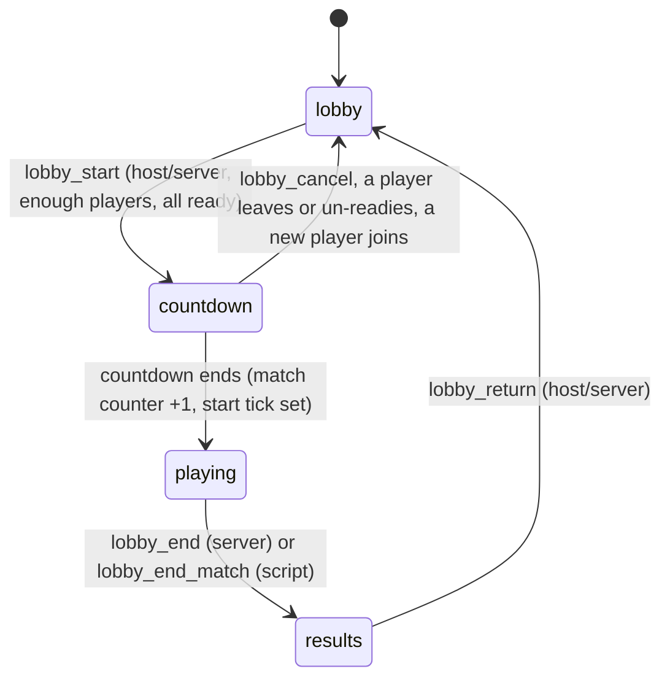

# Lobby

An Age-of-Empires-style lobby for multiplayer games: players connect, sit in the lobby, pick a team and a colour, toggle ready; the host changes the game settings and starts; a countdown runs; the match plays; scripts end it with a verdict and everybody returns to the lobby.

The lobby is **simulation state of the server** ([networking](networking.md)). There is no extra network protocol: its commands travel as ordinary whitelisted commands, the state is hashed with the simulation, saved in snapshots, and replicated to every client with the other extra states ([replication](replication.md)). Package: `net/lobby`.

## Contents

* [The model](#the-model)
* [Turning it on](#turning-it-on)
* [Configuration](#configuration)
* [Phases](#phases)
* [Commands](#commands)
* [Slots, host and countdown](#slots-host-and-countdown)
* [Script API](#script-api)
* [Loading the chosen map when the match starts](#loading-the-chosen-map-when-the-match-starts)
* [Lobby screen](#lobby-screen)
* [Match results convention](#match-results-convention)
* [Go API](#go-api)
* [Limits](#limits)

## The model

* **State** (`sim.Extra` `net.lobby`, hashed): phase, host, match counter, countdown ticks, start tick, one **slot** per player (team, colour, ready, spectator, absent), the **settings** chosen so far and the **results** of the last match.
* **Commands** (journaled, validated again by every `Apply`): `lobby_ready`, `lobby_slot`, `lobby_setting`, `lobby_start`, `lobby_cancel`, `lobby_end`, `lobby_return`. A command that is refused leaves the state untouched.
* **A fixed system** (`lobby.sync`) keeps the slots, the host and the countdown consistent with the player registry of [`net/netsim`](networking.md): it gives new players a slot, drops the slots of players who left, migrates the host and counts the countdown down. It runs first in every tick, before the game's systems and scripts, so scripts always see a synchronised lobby. The player registry changes only through commands applied between ticks, so the order against netsim is the same on every peer.
* **Authority.** Clients may submit every kind except `lobby_end`; the whitelist rules (`lobby.Rules()`) force the `player` field of the payload to the sender, so a client cannot act for another player. Player 0 is the server. Settings, start, cancel and return need the host (or the server); `lobby_end` is the server's (scripts end matches through [`lobby_end_match`](#script-api)).

## Turning it on

Add a `runtime.lobby` section to `vox.project`. `runtime.plugins.net` must be `true` (it is off by default): the lobby reads the player registry.

```json
{
  "runtime": {
    "lobby": {
      "min_players": 2,
      "max_players": 8,
      "teams": 2,
      "team_names": ["Red", "Blue"],
      "countdown_seconds": 5,
      "host": "first",
      "spectators": true,
      "settings": [
        { "key": "map", "label": "Map", "choices": ["meadow", "canyon"], "default": "meadow" },
        { "key": "speed", "label": "Game speed", "choices": ["1x", "2x"] }
      ]
    }
  }
}
```

The section is part of the simulation identity: it is inside the `runtime` hash the handshake pins (`game.NetPins`), so a peer with a different lobby configuration is refused at the handshake. With the section present the game installs `lobby.Plugin` right after `netsim.Plugin`.

## Configuration

| key | type | default | meaning |
|---|---|---|---|
| `min_players` | int | 2 | non-spectator connected players needed to start (1 to `max_players`) |
| `max_players` | int | 8 | non-spectator slots, 1 to 64 |
| `teams` | int | 0 | number of teams, 0 to 16; 0 is free for all (everybody is team 0) |
| `team_names` | list | `Team 1`... | optional display names, exactly one per team (so `teams` must be set), printable UTF-8, at most 32 bytes each; part of the pinned configuration, returned by `lobby_info` (`config.team_names`) |
| `colors` | int | `max_players` | number of colours, `max_players` to 32; colours are unique among players |
| `countdown_seconds` | int | 5 | 1 to 60, counted in ticks (20 per second) |
| `late_join` | bool | false | players connecting during a match get a player slot |
| `spectators` | bool | false | players may watch instead of playing; also where overflow players go |
| `host` | string | `"first"` | `"first"`: the first connected player hosts and the role moves to the lowest connected id when the host leaves. `"server"`: only the server (player 0) changes settings and starts (dedicated servers, matchmaking) |
| `settings` | list | none | up to 16 game settings: `key` (letters, digits, `_ - .`, 32 bytes), `label` (64 bytes), `choices` (1 to 32 values of at most 64 bytes), `default` (one of the choices, else the first) |

Zero fields take the default; invalid values fail `vox.project` validation (`runtime.lobby`).

## Phases



| phase | id | what happens |
|---|---|---|
| `lobby` | 0 | players change team, colour, spectator and ready; the host changes settings |
| `countdown` | 1 | `countdown_ticks` counts down; any change that makes the start invalid returns to `lobby` |
| `playing` | 2 | the match runs; ready flags are cleared; slots of players who leave are kept and marked `absent` |
| `results` | 3 | `results` holds the verdict; `lobby_return` reopens the lobby |

## Commands

All payloads are JSON objects with a `player` field. On the wire the server overwrites it with the sender's id.

| kind | payload | accepted when |
|---|---|---|
| `lobby_ready` | `{player, ready}` | lobby or countdown phase; the player has a slot and is not a spectator. Un-readying during the countdown cancels it |
| `lobby_slot` | `{player, team, color, spectator}` | lobby phase; team and colour in range and the colour free (a spectator sends 0 and 0 and needs `spectators`); a change clears the player's ready flag |
| `lobby_setting` | `{player, key, value}` | host or server, lobby phase; `value` is one of the setting's choices. A change clears every ready flag |
| `lobby_start` | `{player}` | host or server, lobby phase, at least `min_players` connected non-spectators and all of them ready; goes to `countdown` |
| `lobby_cancel` | `{player}` | host or server, countdown phase |
| `lobby_end` | `{player: 0, results}` | server only, playing phase; `results` is JSON, at most 4096 bytes after compaction |
| `lobby_return` | `{player}` | host or server, results phase; clears ready flags and drops the slots of absent players |

Rates per player: `lobby_ready`, `lobby_slot`, `lobby_setting` 5 per second (burst 10); `lobby_start`, `lobby_cancel`, `lobby_return` 2 per second (burst 4); payloads are at most 512 bytes and decoded strictly (unknown fields are refused). Add them to a server whitelist with:

```go nocheck
for kind, rule := range lobby.Rules() {
	wl.Allow(kind, rule)
}
```

## Slots, host and countdown

* **New player.** The first tick after a player connects gives it a slot: team = the least populated team (lowest index on ties; always 0 in a free for all), colour = the lowest free colour. When all `max_players` slots are taken, or a match is running without `late_join`, the player becomes a spectator if `spectators` is on, else gets **no slot** (the server decides what to do with a connected player the lobby has no place for).
* **Leaving.** In the lobby and the countdown the slot disappears (a leave during the countdown cancels it). During a match and in the results phase the slot is kept with `absent: true`; the player's return clears the flag; `lobby_return` drops what is still absent.
* **Host.** With `host: "first"` the host is the lowest connected player id; when the host leaves, the next lowest connected id takes over (a lower id that connects later does not take it back). With `host: "server"` the host is always 0.
* **Countdown.** `lobby_start` sets `countdown_seconds * 20` ticks. Each tick the system re-checks the start condition (enough connected players, all ready) and decrements; at 0 the phase is `playing`, `match` increases and `start_tick` is the tick the match began.

## Script API

Host functions of module `vox` (also in [script ABI](../script/ABI.md) and the [Script API reference](reference/script-api.md)); without `runtime.lobby` they return `UNAVAILABLE`:

| function | result |
|---|---|
| `lobby_phase() i32` | 0 lobby, 1 countdown, 2 playing, 3 results |
| `lobby_info(out, cap) i32` | JSON of the whole lobby: `phase`, `phase_id`, `host`, `match`, `countdown_ticks`, `start_tick`, `slots`, `settings` (key to value), `results`, `config` |
| `lobby_end_match(results, len) i32` | 0. Ends the running match with a JSON verdict (empty = none, at most 4096 bytes); `INVALID`, `REJECTED` when no match is running |

Go SDK: `burrowsdk.LobbyPhase()`, `burrowsdk.ReadLobby()` (a `LobbyInfo`), `burrowsdk.LobbyEndMatch(results)`.

**How scripts end a match.** A script runs inside the tick, where nothing can be journaled, so `lobby_end_match` does not create a command. Like `save_set` it queues an operation that is applied when the script call commits, and the commit calls `lobby.EndMatch` on the lobby state. Every peer (and every replay) runs the same script on the same state, so every peer makes the same transition on the same tick; the `lobby_end` command is the equivalent for the server's own code.

```go nocheck
func OnTick() {
	l, err := burrowsdk.ReadLobby()
	if err != nil || l.Phase != "playing" {
		return
	}
	if winner, done := checkVictory(l); done {
		res, _ := json.Marshal(map[string]any{"winner": winner})
		burrowsdk.LobbyEndMatch(res)
	}
}
```

## Loading the chosen map when the match starts

Settings are plain strings; the game decides what they mean. Detect the start by the match counter (it changes exactly once per match, on the same tick everywhere), read the setting, and load the level:

```go nocheck
var lastMatch uint32

func OnTick() {
	l, _ := burrowsdk.ReadLobby()
	if l.Phase == "playing" && l.Match != lastMatch {
		lastMatch = l.Match // keep it in State if the script can be reloaded
		burrowsdk.LevelLoad(l.Settings["map"], "") // the server's request becomes a journaled level_load for everyone
		// spawn each slot's player at its team's start: l.Slots[i].Team, .Color
	}
}
```

`level_load` is served by the server's frame and reaches clients inside a tick batch ([networking](networking.md#engine-integration)); on clients the request is dropped, so call it from the script on every peer without special-casing. Keep the "last match" in `State` (not in a Go global) when the module can be reloaded or a late joiner restores a snapshot.

## Lobby screen

The game UI template **Lobby** (File > New > Start from > Lobby in the Game UI designer, `gameui.Template("Lobby")`) is a ready-made lobby: a scrolling player list with aligned columns (name, team, colour, ready, under a header row that stays above the scrolling list), a list of spectators, Ready, Team, Colour and Spectate / Play buttons (only the ones that apply to the local player), a scrolling settings list (the host clicks a row to cycle its value; for everybody else the rows are disabled list items: dimmed, no highlight, no command), Start / Cancel start for the host, a countdown, and a results panel (winner or draw, the placements by name in order and, with teams, the team placements: the best place among a team's members, teams named after `team_names`, else "Team 1", "Team 2"...) with Back to lobby (host). The lists scale to any lobby (up to 64 players and 16 settings). The `lobby_match` project template ships it wired to a script (`burrow new mygame -template lobby_match`); its `ui/lobby.ui.json` is the compact JSON of the template.

**How UI events become lobby commands.** Scripts cannot submit commands (they run inside the tick), so the buttons do it on the frame side. A button or list whose action starts with `lobby:` is turned by `gameui/uiplug` (`LobbyCommand`) into the matching command, queued like any frame command; a client's network layer forwards it to the server (`netapp.ClientKinds` already holds the lobby kinds), the whitelist forces `player` to the sender and the simulation validates it again. A listen server's own player submits as itself (not as the server). No script code is needed for input:

| action | command |
|---|---|
| `lobby:ready` | `lobby_ready` with the flag toggled |
| `lobby:team` | `lobby_slot` with the next team |
| `lobby:color` | `lobby_slot` with the next free colour |
| `lobby:spectate` | `lobby_slot` that makes the player a spectator, or back a player on the least populated team with the first free colour |
| `lobby:setting` (a list; `lobby:setting:<n>` names the row) | `lobby_setting` with the value of `lobby_set<n>_next`, n being the clicked row (the host only, the simulation refuses others) |
| `lobby:start`, `lobby:cancel`, `lobby:return` | `lobby_start`, `lobby_cancel`, `lobby_return` |

**What the script publishes.** The screen shows UI values; the script (`burrowsdk.UISetStr/Num/Bool/Items`, only on change) fills them from `ReadLobby`. `lobby_me` (the local player id) is set by the network layer; what depends on it (host buttons, the Ready / Team / Colour / Spectate texts and visibility, the visible panel) is derived by the engine every frame (`uiplug.DeriveLobby`), so the same script serves every peer.

| value | meaning |
|---|---|
| `lobby_phase` (num), `lobby_host` (num) | phase id 0 to 3 and host player id: required, nothing is derived before `lobby_phase` is set |
| `lobby_slots` (str) | `id,team,color,state` entries separated by spaces (state 0 not ready, 1 ready, 2 spectator; 1024 bytes hold 64 players): the data of the buttons |
| `lobby_teams`, `lobby_colors` (num), `lobby_color_names` (str, space separated), `lobby_team_names` (str, tab separated, empty = "Team N"), `lobby_spectators_on` (bool) | lobby configuration |
| `lobby_status` (str), `lobby_countdown` (num, seconds) | status line and countdown |
| `lobby_players`, `lobby_spectators` (items), `lobby_spectators_any` (bool) | one item per player or spectator; a player row is `name<TAB>team<TAB>colour<TAB>status` (the list's `col_widths` align it); the screen's fixed header row is a separate list above it |
| `lobby_settings_on` (bool), `lobby_settings` (items, "Label:  value"; the engine derives `lobby_settings_view` from it, disabled unless the local player is the host, and the screen's list binds that), `lobby_set<n>_key`, `lobby_set<n>_next` (str) | settings list and, per row, the key and the choice a click selects |
| `lobby_result_title` (str), `lobby_result_list`, `lobby_team_list` (items), `lobby_team_results` (bool) | results panel (the team list only with teams): "Winner: x", "Tie for first: x, y" or "Draw", then one "place.  name" line per placement |

The screen is modal: show it in the lobby and results phases (`UIShow("lobby")`) and hide it while the match plays (`UIHide("lobby")`), as `scripts/lobby` of the template does. The screen is data: rename widgets, restyle it or add widgets freely, as long as the values and `lobby:` actions it uses stay.

## Match results convention

`lobby_end_match` accepts any JSON. Games that run on a dedicated server with a matchmaker should use

```json
{ "placements": { "<player id>": 1, "<player id>": 2 } }
```

where the key is the player id as a decimal string and the value the final place (1 is the winner; equal values are a draw or a shared place). This is the shape a dedicated server forwards to a matchmaker. The `lobby_match` template ends its matches this way.

## Go API

```go nocheck
lobby.Install(e *sim.Engine, cfg lobby.Config) error      // needs netsim installed
lobby.Plugin{Config: cfg}                                  // engine.Plugin, add after netsim.Plugin
lobby.Installed(e *sim.Engine) bool
lobby.ViewOf(x sim.Extra, ok bool) (lobby.View, bool)      // from FixedContext.Extra(lobby.ExtraName)
lobby.ViewOfEngine(e *sim.Engine) (lobby.View, bool)
lobby.Rules() map[string]netbase.Rule                      // whitelist rules for the client kinds
lobby.ServerOnly(kind string) bool                         // lobby_end
lobby.EndMatch(x sim.Extra, ok bool, results []byte) error // used by the script host
```

`View` has `Config`, `Phase`, `Host`, `Match`, `CountdownTicks`, `StartTick`, `Slots`, `Slot`, `Settings`, `Setting`, `Results` and `InfoJSON`.

## Limits

| limit | value |
|---|---|
| players per match | 64 |
| slots (players and spectators) | 256 (the player registry bound) |
| teams / colours | 16 / 32 |
| settings / choices per setting | 16 / 32 |
| key / value / label | 32 / 64 / 64 bytes |
| results | 4096 bytes of compact JSON |
| countdown | 1 to 60 seconds |
| command payload | 512 bytes |

The decoder of the state is strict (bounds, sorted slots, ranges, unique colours, settings equal to the configured keys and choices, compact JSON results, canonical varints), so a corrupt or hostile snapshot is refused. A snapshot restores only under the same lobby configuration, which the handshake pins already guarantee.

## See also

* [Dedicated server](dedicated-server.md#lobby-mode): `"mode": "lobby"` hosts matches on a real machine, with `lobby start|end|set` admin commands.
* [Networking](networking.md): the whitelist, pins and limits.
* [Multiplayer scripting](scripting/08-multiplayer.md).
* [Determinism](determinism.md).
