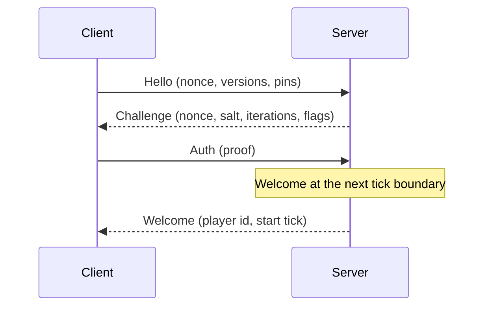

# Networking

Burrow multiplayer is **server-authoritative replication**: the server alone runs the simulation (scripts, physics,
water, block logic, weather) and streams to each client the part of the state around its player. Clients run only frame
stages (rendering, UI, audio, prediction) on the replicated copy and send whitelisted commands. There is one network
model; `burrow serve`, `burrow-server`, the lobby and the matchmaker, `burrowplay -connect` and the editor's host
session all use it. How the state is selected, encoded and budgeted is in [Replication](replication.md).

This page describes the connection layer shared by every server: the protocol (`net/wire`), the transports
(`net/transport`), the handshake, security and limits (`net/gate`, `net/netbase`), the simulation side (`net/netsim`),
the engine integration (`net/netapp`, `internal/netplay`) and how to play. For an always-on headless server see
[Dedicated server](dedicated-server.md); for matches between players, the [Lobby](lobby.md).
The player registry is off by default; `runtime.plugins.net: true` installs it.

## Contents

* [What a game author must know](#what-a-game-author-must-know)
* [Playing: host, join, editor](#playing-host-join-editor)
* [Engine integration](#engine-integration)
* [Remote player movement](#remote-player-movement)
* [Using the API](#using-the-api)
* [Protocol](#protocol)
* [Security and threat model](#security-and-threat-model)
* [Limits](#limits)
* [How it is tested](#how-it-is-tested)
* [What is not covered](#what-is-not-covered)
* [FAQ](#faq)
* [Joining and hosting from the game](#joining-and-hosting-from-the-game)

## What a game author must know

* **The server simulates, clients show.** Fixed systems and scripts run on the server only. A client never steps its
  copy of the simulation, so its `StateHash` and journal mean nothing.
* **Keep client-visible state in components, not in script State.** Script `State` (inventories, furnaces, skills kept
  in a table) stays on the server. What a client must display or read goes in a component, replicated to everyone, to
  the owner only or to nearby clients: see [Component visibility](replication.md#component-visibility).
* **All state changes are commands.** A frame system that changes the simulation from local input (keyboard, mouse, UI
  clicks) must submit a command instead of applying it: the engine's command router (`App.SetCommandRouter`) takes such
  commands away and sends them to the server.
* **Read player input from the registry.** `netsim.Lookup(e, id).Input` is the input the player sent for this tick:
  quantized integers (movement axes in thousandths, yaw and pitch in millidegrees, a button bit field). Use
  `netsim.Quantize` to build one from floats.
* **Client commands are whitelisted.** By default a client may submit `net_player_input`, `set_block`, `block_use` (a
  right click on an interactive block), `fill_box` (at most 4096 voxels), `fill_sphere` (radius at most 8) and
  `micro_edit` (at most 16 edits and 128 listed voxels, no raw `put`), each with its own rate limit. Anything else is
  rejected and counted. A game adds its own kinds with `Whitelist.Allow`, with a validator that checks the payload and
  rewrites it into its canonical form; the simulation validates every command again when it applies it.
* **Do not trust a command's claim of who sent it.** The default validator of `net_player_input` forces the player id
  to the sender.
* **Chat is not simulation state.** It travels next to the frames. Moderation (kick, ban, whitelist), passwords, identity
  and TLS pinning are the same on every server.
* **Pins.** The server rejects a client whose engine version, project content hash, configuration hash, seed or pinned
  rule versions (for example the fine water rules) differ. `netbase.HashFS` computes the project content hash.
* **World scale.** A world with a voxel size other than one metre (or `texture_scale` `metre`) adds the pin rules
  `world.voxel_size` and `world.texture_scale`. A client with another size is refused with `CodeProject` and "world voxel
  size: server 0.25 m, client 1 m"; the player installs the matching project.

## Playing: host, join, editor

1. Add `"net": true` to `runtime.plugins` in `vox.project`. Players need the same project files and engine version.
2. Host: `burrow serve [dir | game.voxpak]`. It listens on `:7777` with TLS 1.3 (`--addr`), creates its certificate on
   first run in `<user config dir>/burrow/server` (`server.key` mode 0600), and prints

   ```
   join link: burrow://host:7777?fp=<certificate fingerprint>&key=<password>
   ```

   The key is random unless you pass `--password` (or the `BURROW_SERVE_PASSWORD` environment variable) or `--open`.
   `--advertise host:port` writes your public name in the link. Treat a link with a key as a secret. Chat lines arrive
   on stderr.
3. Join: `burrowplay -connect <link> [-name ana] [project]`. The link's fingerprint pins the certificate; without one the
   first connection trusts the certificate and remembers it in `<user config dir>/burrow/known_servers`, and a changed
   certificate is refused. The reconnect token of each server is kept in `<user config dir>/burrow/tokens.json` (mode
   0600): after a lost connection the client redials for about 30 s and takes its slot back. Lines typed on stdin (and
   `-say text`) are chat. `-headless -ticks N` follows the server for N ticks (for tests).
4. Editor: **Play > Host multiplayer session** runs the open project as a listen server whose first player is the editor
   user. While the session runs, editing, undo, redo and manual stepping are disabled (`ErrNetLocked`): the session owns
   the simulation. **Stop** ends the session and restores the document exactly as Play does.

## Engine integration

* **The plugin.** `runtime.plugins.net` installs `netsim.Plugin` (the player registry and the `net_player_*` commands).
* **Server ticks.** A tick is `App.StepFixed`: flush the queued commands, run the plugins' pre-tick hooks
  (`App.OnPreTick`), run exactly one fixed tick, flush again. Frames (input, UI, rendering) run on their own with
  `App.Frame`; the app is in manual step mode (`netapp.Attach`), so a frame never ticks. A host loop is: `Poll` the
  server, then `App.Frame`.
* **The command router.** `netapp.Link` installs `App.SetCommandRouter`, so commands that frame systems queue never
  change the simulation on their own:

  | command | server (dedicated or listen) | client |
  |---|---|---|
  | `script_set_input`, `script_bind`, `script_module_changed` | dropped | dropped |
  | `gameui_event`, `set_block`, `block_use`, `fill_box`, `fill_sphere`, `micro_edit`, `net_player_input` | `Server.Submit` | `Client.Submit` (whitelisted) |
  | any other (for example `level_load`) | `Server.Submit` | dropped: the server's own frame produces it |

  `script_set_input` is replaced by the per-player input of the registry (`net_player_info`,
  [scripting](scripting/08-multiplayer.md)). A game adds client-submittable kinds to `netapp.ClientKinds` and to the
  server whitelist (`netplay.WhitelistFor` shows how `gameui_event` is added).
* **The controller.** With a session the first-person `app.Controller` sends its block edits through the link
  (`Controller.SetNetwork`) instead of `Do`, stops stepping the simulation, and its undo/redo are off.
* **Restore.** `App.RestoreSnapshot` runs `App.OnRestore` hooks so each plugin rebuilds its frame-domain state (a
  dedicated server restoring its world, the editor stopping a session).
* **The lobby.** `runtime.lobby` adds `lobby.Plugin` after `netsim.Plugin`: players, teams, colours, ready flags,
  settings, the countdown and the match results as simulation state replicated to every client (`lobby_*` commands go
  through the whitelist, `lobby.Rules()`). See [lobby](lobby.md).
* **Pins.** `game.Game.NetPins` fills the handshake pins: toolchain version (`game.Version`), the content hash of the
  project files (`netbase.HashFS`; `saves/` and dot files are skipped), the hash of the `runtime` section without its
  presentation fields, the seed, the tick rate and the fine water rule version when fine water is on.

## Remote player movement

Every applied `net_player_input` also moves the player's node (`netsim/move.go`): yaw on the node, pitch on its camera,
and one tick of walking along the move axes at `player.move` speeds against solid blocks. Jump, sprint and crouch follow
the local controller's rules from fixed button bits (`netsim.ButtonJump`, `ButtonSprint`, `ButtonCrouch`);
`internal/netplay.InputFromState` sets the bits from the input actions named `jump`, `sprint` and `crouch` (or `sneak`).
A player without `player.move` does not move. A joining player appears at the `game.mode` spawns unless the server
placed it with `net_player_spawn`. The local avatar is predicted on the client (`replica.Smoother`) and corrected by
the server; the other players are interpolated.

## Using the API

```go nocheck
// server (dedicated): a listener, the authoritative simulation, the pins
ln, _ := transport.ListenTCP(":7777", transport.TCPOptions{TLS: transport.ServerTLS(cert), Notify: wake})
srv, _ := replica.NewServer(replica.ServerConfig{Sim: &netapp.AppSim{A: app}, Listener: ln, Pins: pins, Password: "optional"})
for { srv.Poll(time.Now()); app.Frame(dt) }

// client: dial with the fingerprint of the join link, then poll from the frame loop
c, _ := replica.Connect(ctx, link.Addr, netbase.ConnectOptions{Fingerprint: link.Fingerprint},
	replica.ClientConfig{Target: app, Pins: pins, Name: "ana", Password: link.Key})
for running {
	c.SubmitInput(netsim.Quantize(moveX, moveY, yaw, pitch, buttons))
	c.SetView(camX, camY, camZ)
	c.Poll(time.Now())
}
```

* `Server` and `Client` are poll-driven: `Poll(now)` does a bounded amount of work and never blocks, so a host can drive
  them from its frame loop and a test can drive a whole session from one goroutine on a virtual clock.
* Callbacks (`OnPlayerJoin`, `OnPlayerLeave`, `OnChat`, `OnEvent`, and `OnFrame`, `OnReconcile` on clients) run after the
  Poll's work, outside the session's lock. The shared types are in `net/netbase`.
* Host controls: `Submit`, `AddLocalPlayer` and `SubmitAs` (a listen server's own player), `Kick`, `Chat`, `Metrics`,
  `Peers`, `Close`; hooks `AllowConnect` (ban list by address) and `AllowJoin`.
* A join link looks like `burrow://host:7777?fp=<certificate fingerprint>&key=<password>` (`netbase.JoinLink`,
  `netbase.ParseJoinLink`). Treat a link with a key as a secret.

## Protocol

### Framing

The transport carries frames. On TCP each frame is a 4-byte big-endian length followed by the payload; a length of 0 or
above the limit (1 MiB by default) closes the connection before anything is allocated. A frame is one message: a type
byte, then the fields. Field encodings: `uv` is an unsigned LEB128 varint (minimal encoding only), `u8` one byte, `u64`
eight bytes little endian, `[n]` n raw bytes, `str` a `uv` length then UTF-8 bytes, `bytes` a `uv` length then raw
bytes, `bool` one byte 0 or 1. Decoding is strict: every length and count is checked against its limit and against the
bytes that remain, trailing bytes are an error, and a value has exactly one encoding.

### Messages

| type | name | direction | fields |
|---|---|---|---|
| `0x01` | Hello | C→S | `[4]` magic `BRWN`, `uv` protocol version, `str` engine version (≤64), pins, `str` name (≤32), `[32]` client nonce, `[8]` token id (zero: new player), `[32]` identity (ed25519 public key, zero: anonymous) |
| `0x02` | Challenge | S→C | `[32]` server nonce, `[16]` salt, `uv` PBKDF2 iterations, `u8` flags (1 password, 2 token, 4 replication server) |
| `0x03` | Auth | C→S | `[32]` password proof, `[32]` token proof, `[64]` identity signature (zero when anonymous) |
| `0x04` | Welcome | S→C | `uv` player id, `[32]` reconnect token, `[32]` server proof, `uv` start tick, tick length (µs) |
| `0x05` | Reject | S→C | `u8` code, `str` detail (≤256) |
| `0x10` | Input | C→S | `uv` seq (strictly increasing), `uv` count (≤16), then per command `str` kind, `bytes` JSON payload (≤4 KiB) |
| `0x40` | Ping | both | `uv` seq, `u64` sender time, `uv` ack |
| `0x41` | Pong | both | `uv` seq, `u64` echoed time, `uv` server tick |
| `0x50` | Chat | C→S | `str` text (≤256) |
| `0x51` | ChatMsg | S→C | `uv` from, `str` text |
| `0x60` | Kick | S→C | `u8` code, `str` detail |
| `0x61` | Bye | both | `u8` code |
| `0x70`-`0x74` | RepSchema, RepFrame, RepAck, RepView, RepFrameZ | both | the replication stream, see [Replication](replication.md#protocol) |
| `0x80` | VoiceUp | C→S | `bytes` voice frame (1..256, [voice chat](voice.md#format-and-bandwidth)): the sender's own voice |
| `0x81` | VoiceDown | S→C | `uv` speaker (≥1), `bytes` voice frame (1..256), forwarded unchanged |
| `0x82` | VoiceBlock | C→S | `uv` player (≥1), `bool` blocked: a personal mute the server applies to the sender's copies |

Pins: `[32]` project content hash, `[32]` configuration hash, `uv` seed, `uv` rule count (≤32), then sorted unique
`str` key and `str` value pairs (≤64 bytes each).

Reject and kick codes: 1 version, 2 project, 3 authentication, 4 full, 5 banned, 6 timeout, 7 protocol, 8 rate limits,
11 shutdown, 12 kicked, 13 busy, 14 connected elsewhere, 15 quit, 16 identity required.

The golden test in `net/wire` pins these bytes: a change is a protocol change and bumps the protocol version. (The wire
package still defines the messages of the removed lockstep model; the server kicks a client that sends one.)

### Handshake and authentication



1. The client sends Hello with a fresh nonce. The server checks the protocol version, the engine version and the pins
   (a mismatch is a Reject that names the field), and the player count.
2. The server answers with a Challenge: its own nonce, the salt and iteration count of the password key, and flags.
3. The client answers with Auth. With a password, the shared key is `PBKDF2-SHA256(password, salt, iterations)` and the
   proof is `HMAC-SHA256(key, "burrow-net v1 client proof" ‖ 0 ‖ SHA-256(Hello ‖ Challenge))`. A reconnecting client
   proves its token the same way; the Hello only carries the token id. Neither the password nor the token is ever sent
   again; proofs are compared in constant time.
4. A client with an identity key (ed25519) names its public key in Hello and signs `"burrow-net v2 identity proof" ‖ 0 ‖
   SHA-256(Hello ‖ Challenge)` in Auth. The server always verifies the signature when the key is not zero and keeps the
   key on the player's record; a reconnect must present the same key. A server with `RequireIdentity` rejects anonymous
   clients with code 16.
5. With a password the Welcome carries the server proof, so the client knows the server has the password too.

Client side states: `connecting → handshake → syncing → playing → closed`. `Reconnect` moves a lost client back to
`connecting` with its token; the server keeps the slot for the reconnect grace period.

## Security and threat model

Network input is hostile until proven otherwise. What the core defends against:

* **Malformed and oversized input.** Every length and count is bounded before allocation; a frame over the limit closes
  the connection; a malformed message ends that connection. Message handling recovers from panics at the connection
  boundary and counts them; no other peer is affected.
* **Flooding.** Per connection: messages per second, bytes per second, commands per kind per second, pending commands,
  chat lines per 10 seconds. A rejected message or command is a violation; too many violations in the window disconnect
  the client. At most 64 messages per connection are read per Poll.
* **Forbidden or forged commands.** Only whitelisted kinds pass, each with a size limit and a validator; the simulation
  validates again. Older Input sequence numbers are rejected. A client cannot submit joins, leaves, seeds, steps or
  editor commands, nor act for another player.
* **Slow clients and slowloris.** Handshakes time out (10 s, 3 s while the Hello is still missing); the number of
  handshakes in progress is bounded (32 in total, 4 per address group); 5 failed authentications from one address group
  lock it out for 30 s; idle connections time out (15 s); TCP limits connections per address group (8) and in total
  (64); the TLS handshake runs off the accept loop with its own deadline.
* **Information.** A client receives only its interest and the component values its visibility rules allow
  ([Replication](replication.md#security)).
* **Passwords.** Challenge-response with PBKDF2 and HMAC: the password never crosses the wire, even without TLS. A client
  that has a password refuses a server that does not ask for it, and refuses an iteration count outside
  [10 000, 4 000 000]. Without TLS an eavesdropper can still try passwords offline against a recorded handshake, and the
  reconnect token in the Welcome is visible: use TLS on untrusted networks.
* **TLS.** TLS 1.3 only. The server generates a self-signed ECDSA P-256 certificate on first run. The client pins the
  certificate's SHA-256 fingerprint: from the join link, or trust on first use stored in
  `<user config dir>/burrow/known_servers`; a changed certificate is refused. There is no mode that accepts any
  certificate.
* **Logs.** Events, logs and errors never contain passwords, keys or tokens.
* **Identity.** A player is its ed25519 key, not its name: names are display only unless the server maps names to keys
  (the dedicated server refuses a name already owned by another identity). The key never leaves the client
  (`<config dir>/burrow/identity.key`, mode 0600). Keys are not certified: a new key is a new player.

Not defended against: a malicious *server* (play on servers you trust), denial of service by bandwidth exhaustion below
the transport, and an active attacker on a plaintext TCP connection after authentication (use TLS).

## Limits

| limit | default | where |
|---|---|---|
| players per server | 256 (max 1024) | `ServerConfig.MaxPlayers` |
| tick rate | 20 Hz (50 ms) | `sim.TickRate`; `TickInterval` only for tests |
| frame size | 1 MiB | `transport.Limits.MaxMessage` |
| send budget / receive budget per connection | 4 MiB / 2 MiB | `transport.Limits` |
| commands per Input message | 16 | `wire.MaxCmdsPerInput` |
| client command payload | 4 KiB (default rules: 256 bytes) | `wire.MaxClientCmdData`, `Rule.MaxBytes` |
| commands of one player per tick | 8 (the rest wait for the next ticks) | `MaxCmdsPerTick` |
| pending commands per player | 64 | `MaxPendingCmds` |
| messages per connection per Poll | 64 | `MsgsPerPoll` |
| message rate / byte rate per client | 200 /s, 256 KiB/s | `MsgRate`, `ByteRate` |
| violations before disconnect | 50 in 10 s | `ViolationsToKick`, `ViolationWindow` |
| chat | 256 bytes, 5 lines per 10 s | `wire.MaxChat`, `ChatPer10s` |
| handshakes in progress | 128, 4 per address group | `MaxHandshakes`, `MaxHandshakesPerIP` |
| failed authentications | 5 per address group, then 30 s lockout | `AuthFailuresToLock`, `AuthLockout` |
| timeouts | hello 3 s, handshake 10 s, idle 15 s | `*Timeout` |
| reconnect grace | 60 s | `ReconnectGrace` |
| TCP connections | 64 total, 8 per address group, 2 TLS handshakes per address group, 32 waiting | `TCPOptions` |
| password key | PBKDF2-SHA256, 600 000 iterations (clients accept 10 000 to 4 000 000) | `Iterations`, `MinIterations`, `MaxIterations` |

The replication limits (view distance, bandwidth, entities per client) are in [Replication](replication.md#limits).

## How it is tested

* `net/wire`: round trip of every message, every truncation rejected, golden bytes, limit violations, and `FuzzDecode`.
* `net/transport`: the in-memory fault injector is reproducible from its seed; budgets, oversized frames, close, break
  and partition; TCP framing, a forged 1 GiB length, per-address limits; TLS pinning with the expected fingerprint, a
  wrong one, trust on first use and a changed certificate.
* `net/replica`: see [Replication](replication.md#how-it-is-tested): joins, leaves, chat, kicks, authentication,
  hostile clients, component visibility.
* `net/netapp`, `internal/netplay`, `internal/dedicated`, `cmd/burrowplay`: the command router policy, the networked
  controller, a host and guests built from the sandbox template over loopback TCP with TLS, pins, the token store, the
  lobby and matchmaker modes, a dedicated server restarting from its save, and `burrowplay -connect -headless` against a
  running host.
* `make net-test` runs the fast suite (net and internal/netplay) with `-race`.

## What is not covered

* Chat has no on-screen box yet: it is a terminal line (`burrowplay`, `burrow serve`) and a log in `netplay.Host.Chat` /
  `Guest.Chat`.
* UDP, LAN discovery and relays. The in-memory transport models a reliable ordered stream, like TCP.
* The engine draws remote players only when the game gives their avatars the `character` component; otherwise a game
  draws them from the replicated avatars and `net_player_info`.

## FAQ

**Why server-authoritative replication and not lockstep?** One model has to serve both a four-friend session and a
persistent public world: the server holds the truth, a client downloads only what is around it, cannot read what a
visibility rule withholds, and a slow or modified client cannot desynchronise anyone.

**Can a client cheat by sending commands?** Only whitelisted commands, within limits, validated twice. A client can
always lie about its own input (like in any game); it cannot act for someone else or change the rules.

**Does a slow player slow everyone down?** No. The server ticks on time and each client has its own bandwidth budget.

**Is my password safe on a LAN without TLS?** It is never sent, but a recorded handshake allows offline guessing: use a
long password, or TLS.

## Joining and hosting from the game

A windowed game does not need `burrowplay -connect`. Its menus (`net:join:<link>`, `net:host`, `net:server_add`, see
[game UI](game-ui.md)) and its scripts (`NetJoin`, `NetHost`) ask the launcher, which ends the current run and then:

* **join**: plays on the server of the link, as `-connect` does. If the connection fails the launcher prints the error
  and returns to the title screen.
* **host**: builds the game, starts the embedded server (`runtime.plugins.net` is required, same as `burrow serve`) with
  you as its local player, prints `join link: burrow://...` on the console and plays on it.

Saved servers of the "servers" list live in `servers.json` in the user config directory (`<config>/burrow/servers.json`,
at most 64 `burrow://` links).
