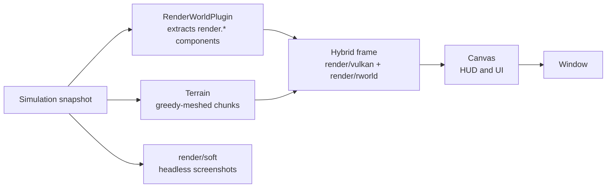

# Rendering

Rendering is frame-domain: it reads a snapshot of the simulation and never changes it.



* **Vulkan renderer** (`render/vulkan`, Vulkan 1.3 dynamic rendering, on macOS through MoltenVK): voxel terrain with greedy-meshed chunks, ambient occlusion,
  a shadow cascade, water, sky and fog, HUD; plus the **scene frame** (`render/rworld`): cameras, directional and point lights, mesh instances,
  sprites (optionally billboards), voxel models, PBR-lite materials (Lambert + emissive, alpha opaque/blend/mask) and custom SPIR-V shaders. Terrain and scene render
  in one hybrid frame, so meshes cast and receive terrain shadows.
* **`RenderPlugin`** drives the window; **`RenderWorldPlugin`** extracts the scene components every frame (`render.camera`, `render.dirlight`,
  `render.pointlight`, `render.mesh`, `render.sprite`, `render.voxmodel`, `render.material`). With no active camera node the player's camera is used.
* **Canvas** (`render/canvas`) is the 2D layer used by the HUD and the UI toolkit (`ui`): rects, lines, images, text. It has a Vulkan backend and a deterministic CPU rasterizer
  (`render/canvas/soft`) used for golden-image tests.
* **CPU renderers** for headless work: `render/soft` (voxel raycaster, used by `SoftRenderPlugin`, `burrowshot` and the editor/agent screenshots without a GPU).

## Distance level of detail (chunk LOD)

Far chunk columns are meshed coarser, so the view distance stays usable and a world with smaller voxels does not pay 64x the geometry per volume. A column is drawn at LOD 0 (full detail, the ordinary mesher), LOD 1 (2x2x2 voxels per cell), LOD 2 (4^3) or LOD 3 (8^3), chosen from the horizontal distance to the camera **in metres** (`mesh.LODConfig`): defaults 160 / 320 / 640 m, with an 8% hysteresis band so a camera on a ring edge does not re-mesh back and forth. Chunks of a column share the level.

- A LOD cell is solid when at least half of its voxels are (surface error under one cell), liquid when at least half are liquid; its block is the top-most solid voxel, so the surface keeps its grass or sand colour. LOD 1 faces are textured (the block texture sampled per voxel like the near mesh, mips averaging it; `LODOpts.TexLOD`, no extra vertices), LOD 2 and 3 keep flat averaged colours (nothing shimmers). LOD meshes use the normal vertex format, no light and no ray tracing data, and go through the same terrain passes and fog. Shadows reach only as far as the shadow cascades do.
- Cross-fade: a column that changes level is re-meshed and the renderer keeps its old mesh for 350 ms (`mesh.Mesh.Fade`, a ghost with every part: opaque, cut-out, glass and water) while both are drawn through a screen-door dither with complementary thresholds (`pc.b.z`, `lodfade.glsl`): no pop, no blending pass, no extra vertices. Glass and water use the same dither (each pixel is kept or discarded, never blended twice), so the fade needs no extra sorting. Shadows: both meshes cast while they dissolve, through the same dither in the shadow map (`shadowcut.frag`; a fading chunk leaves the depth-only fast path for the alpha-test pipeline) and the shadow filter blends the two silhouettes; switching the caster at the midpoint would pop the whole shadow in one frame. Edits and first loads do not fade.
- Seams: the outer ring of cells keeps a cell solid as soon as one voxel is, and every solid border cell emits a full-height wall, so chunks of different levels close each other without cracks (`TestLODSeamsWatertight`).
- Meshing runs on the stream workers from the full-detail data; the base cache that holds it is bounded (`baseCacheChunks`, 4096 columns at most however far the view reaches).
- API: `VoxelWorld.SetLOD(mesh.LODConfig{VoxelSize: 0.25, ...})` or `SetVoxelSize(0.25)` (metres per voxel; rings keep their size in the world), `LODConfig.Off` for full detail everywhere. Debug: `BURROW_LOD=0` turns the default off, `BURROW_LOD_RINGS="160,320,640"` sets the rings.
- **Coarse sampling.** A generator that is a height field (`worldgen.Heightmap`, `worldgen.Flat`, `worldgen.Biomes`, and `worldgen.Scaled` over a sampled generator) implements `worldgen.ColumnSource`: the
  streamer then meshes the LOD 2 and LOD 3 chunks from column samples (`worldgen.CoarseField`, one lookup per cell, the same half-solid and border rules) and
  does not generate the full-detail chunks of those columns or of their neighbours (about 5-7x less work per chunk, and the base cache stays small). It falls back
  to the full generation when the generator cannot be sampled, when an edited chunk lies within one chunk of the build, and
  after `SetWorldGenHints` swaps the generator. Caves lie below the dirt layers and are not seen at those levels. Trees and plants are left out of the samples (a tree is a stray cell or two at 4-8 voxels per cell): they appear at LOD 0 and 1 only. `Biomes` samples its terrain model per column (ground, water level, surface rule from the four-neighbour slope; no ice, ores or vegetation); `Scaled` scales the inner column rows by `N`. Chunks at LOD 0 and 1 are unchanged and
  `Generate` (the bytes of every scale) is untouched. `MaxRadius` is 96 columns: the ray tracing table (256 x 32 x 256, `docs/ray-tracing.md`) holds
  `2(r+2)+1` columns without aliasing up to 125, LOD chunks carry no ray tracing data, and the base cache is capped at 4096 columns whatever the radius.

## Block textures (terrain)

The terrain draws the embedded block textures (`assets/blocktex`, see [texture-packs.md](texture-packs.md)) with LabPBR shading.
Flags: `-textures default|none`, `-pbr=false` (albedo only), `-texfilter nearest|linear`, F5 toggles textures in the sandbox,
`-gallery` shows every textured block in a grid (`examples/voxel_sandbox`).

### Texture scale and distances in metres (small voxels)

A world with 1/2, 1/4 or 1/8 m voxels (`runtime.generator.voxel_size`) draws every block texture per voxel by default (`texture_scale: "voxel"`), so a stone tile is 4x smaller at 0.25 m. `texture_scale: "metre"` (world dialog of the editor, `runtime.generator.texture_scale`, `editor/core.GenParams`) samples the textures in world space instead: one tile spans one metre (`n` voxels). The mesher (`mesh.Opts.MetreTex`) keeps the UVs in voxel units and adds the voxel position along the texture axes modulo `n` (`mesh/tilescale.go`), so faces of one block are seamless across voxels, merged quads and chunk borders; the vertex shader divides by `pc.b.y` (`Mesh.TexDiv`, per chunk) and the REPEAT sampler of the texture array wraps. Slabs, stairs and other solid shape faces tile the same way; plants and other planes keep one texture per voxel. At most `16 - n` blocks are merged per fine quad (UV byte). It is render only (not hashed) and does nothing at 1 m voxels.

Distances are in metres whatever the voxel size: `RenderPlugin.Far`, a scene camera's `far` and `env.fog` `distance` (fog end; start at a fifth of it) are multiplied by the voxels per metre (`engine.MetresToUnits`, `rworld.Input.Unit`); the default far plane follows the streamed radius. Scale 1 is unchanged.

* **Mesh** (`mesh.Opts.Layers`, a `mesh.LayerProvider`): vertices carry `Layer` (layer+1, 0 = flat colour), `UV` in block units
  (a 4x2 merged quad spans U 0..4, V 0..2; the REPEAT sampler tiles it) and `Tinted` (Color is then the biome tint). Faces merge only when
  block, AO and tint agree. U runs along the texture's right axis, V down, seen from outside: side faces up = +Y, top right = +X / up = -Z.
  Without a provider the mesh is the old flat one.
* **Vulkan** (`render/vulkan/blocktex.go`): three `2D_ARRAY` images (one layer per `blocktex.Table` layer, CPU mip chain uploaded through
  staging, nothing generated on the GPU): albedo `R8G8B8A8_SRGB` (the swapchain is sRGB and water blends in linear light, so the hardware decodes
  before filtering and the shader re-encodes with the exact sRGB curve), normal and specular `R8G8B8A8_UNORM`. One REPEAT sampler; `-texfilter nearest`
  samples the nearest texel and mip, `-texfilter linear` (default) uses trilinear minification with up to 8x anisotropy (when the
  device has `samplerAnisotropy`) and LINEAR magnification that `texelAA()` in `voxel_body.glsl` turns back into crisp texels with
  edges antialiased over one screen pixel (no shimmer on low-resolution textures up close). Voxel vertex is 16 bytes (`layer | u<<16 | v<<24`). Descriptor set 2
  of a dedicated voxel pipeline layout holds the arrays (a neutral 1x1 set is bound when textures are off); push constants are unchanged (`pc.a.w` =
  mode 0 flat, 1 albedo, 2 PBR). Only the albedo/normal/spec samplers plus the shadow sampler are used in the voxel fragment shader (4 total).
* **Shader** (`shaders/voxel.frag`): per-face TBN from the face id (no tangent attribute), LabPBR decode (`n.xy = rg*2-1`, `z = sqrt(1-|xy|^2)`, AO from B
  at 60 % strength, roughness `(1-s)^2`, F0 = g/255 for g <= 229, metal for 230..255 with albedo as F0, emission `a/254` x albedo, 255 = none), sun
  Lambert + GGX (Schlick-GGX visibility, Schlick Fresnel) + a sky-gradient reflection scaled by smoothness squared, existing AO, shadow and fog.
  Cut-out texels (leaves, alpha < 0.5) are discarded. Blocks without a texture (water, unmapped) take the old flat path (layer -1).
  **Glass pass.** Solid non-opaque blocks named `glass`, `ice` or `*_glass` (`blocktex.Translucent`) are drawn in an alpha-blended pass after the water: same
  shader as the opaque path (`shaders/glass.frag` = `voxel_body.glsl` with `GLASS`), alpha = albedo texel alpha (glass pane 46/255 with an opaque frame and glints,
  ice 178/255; flat colours 0.35), no depth write, cull off, chunks sorted back to front (per-chunk granularity: two translucent blocks in one chunk can order wrongly).
  Their frames still cast cut-out shadows. `render/soft` blends the entry and far face the same way. Limits: water behind glass is drawn before it (right) but glass behind water is blended over it.
* **CPU twin**: `assets/blocktex/pbr` holds DecodeNormal / Roughness / F0 / Emission / Fresnel / GGX / TBN, used by `render/soft` (set
  `render.Options.Textures`; nearest texel, mip from the ray footprint) and unit-tested against hand values. Keep `pbr` and `voxel.frag` in sync.
* **Engine**: `VoxelWorldPlugin.Textures`, `RenderPlugin.Textures/TexFilter/NoPBR`, `RenderWorldPlugin.Textures` ("" = auto: default pack when
  compiled in). `*engine.BlockTextures` (resource) maps registry names to blocktex (`BlockTextureName`: grass -> grass_block, wood -> oak_log,
  leaves -> oak_leaves, ...), builds the layer table once and rebuilds (appending layers) when blocks are registered later. `SoftRenderPlugin.Textures = "default"` opts in.
* **Cost** (M2 Max, 16x16, 5 mips): 4 KiB per layer (albedo + normal + spec with mips), 0.16 MiB for the 42 layers of the gallery.

### Animated block textures

A block texture PNG taller than wide (height a whole number of stacked squares) is an animation strip, as Pixel Perfection ships fire, lava, portals or magma, and as a project can ship in `textures/block/<name>.png` for its `runtime.custom_blocks`. The frames are kept as extra texture-array layers after the base layers (`LayerSet.Anims`, `blocktex.Anim`); the chunk mesh still carries one base layer per face, so animating never re-meshes.

- Timing: an optional `<name>.png.mcmeta` next to the PNG (`animation.frametime` in ticks of 1/20 s, `animation.frames` for the order and per-frame times). A strip without one plays in order at `blocktex.DefaultFrameTime` (2 ticks) per frame. Faces with a tinted overlay, glass and ice stay on frame 0.
- Budget: frames share the 2048-layer array (`blocktex.MaxLayers`); an animation that does not fit stays on its first frame, at most `blocktex.MaxAnims` (64) textures animate, and a device whose `maxImageArrayLayers` is lower than the total uploads the base layers only.
- GPU: a table of animated base layers (base layer, first frame layer, steps, ticks per step) lives at the end of the scene UBO and `animLayer()` in `shaders/common.glsl` picks the layer in the voxel and shadow-cut fragment shaders from `S.view.z`, the frame's tick.
- CPU: `render/soft` uses the same table and `blocktex.AnimStep` with `render.Options.AnimTick`; `engine` screenshots pass the world tick, so a headless shot shows the same frame as the window. `AnimTick` 0 shows each texture's first frame.
- The clock is a rendering input only: it is read from the frame state and never written to the simulation or `StateHash`.
- Block icons, thumbnails and `blocktex.Image` always show frame 0.

## Screenshots

```sh
burrowplay -shot out.png -frames 60 mygame            # GPU, hidden window, 1280x720 by default
burrowplay -ticks 300 -shot out.png mygame            # warm start: 300 real fixed ticks first, then render
burrowplay -freeze -shot out.png mygame               # reproducible: no sim ticks while the shot settles, sky/water frozen
burrowshot -scenario tower -out tower.png             # CPU renderer, no GPU
```

`-ticks N` with a window runs N real fixed ticks first (journaled `Step` commands, so the run is replayable); `-shot` always runs at least one so derived state exists in the first frame.
Without `-freeze` the game keeps simulating while the shot settles (`-frames` frames at one fixed tick each) and the sky/water animate, so the picture depends on `-frames`.
`-freeze` is explicit: the debug driver feeds zero time (no ticks while settling) and pins the sky and water animation, which is what makes screenshots reproducible. `make view-test` and the editor selftest use it.

## Device limits

The block texture arrays use one layer per texture: the layer cap is `min(2048, VkPhysicalDeviceLimits.maxImageArrayLayers)` and a pack over it fails with an error naming both limits
(`maxImageDimension2D` bounds the texture size). `none` packs are unaffected. Emission mips decode the 255 "none" marker before averaging (glowstone keeps glowing at distance).

## Parity and tests

`make render-test` renders the showcase scenes on the GPU and compares them with the CPU renderer within measured tolerances; shader and validation-layer errors fail the run
(`VUID` / `Validation Error` in the log). `make view-test` does the same for the terrain viewer; both renderers are textured there. Textures raise the
Vulkan-vs-soft mean difference (4.6 / 4.8 / 7.2 vs 3.5 / 3.3 / 5.6 flat) because the GPU picks mips per 2x2 quad and soft per ray footprint; the thresholds in
the Makefile are measured + 25 %. Textured soft output is deterministic across worker counts (golden keys `terrain_tex*` in `render/soft/testdata/golden.json`).

## MoltenVK notes

* MoltenVK limits shape the renderer (no mutable comparison samplers; FIFO presentation). Always validate changes with the validation layer (`make render-test` fails on any `VUID`).
* `burrowplay` links MoltenVK directly (`libMoltenVK.dylib`), so no Vulkan loader is needed to play; the validation layer (`-validate`) does need the loader and `VK_LAYER_PATH`.
* Retina: windows render at the framebuffer size; screenshot runs use point size (`NoRetina`) for stable output.

See [troubleshooting.md](troubleshooting.md) for failures.

## T3 notes

* Tint: `albedo = texel * tint * TintGain(1.65)` in sRGB space, scaled by `1/max` when a channel exceeds 1 (hue-preserving; was a per-channel clip; same in the shader, `render/soft` and thumbnails; pixel-identical on the default pack views) (see docs/texture-packs.md); tinted-face AO is softened.
* Shadow map: opaque terrain uses the depth-only pipeline; leaf faces use `shadowcut` (alpha test on albedo, layer < 0 stays solid).
  `BURROW_CUTSHADOW=0` = old full-block leaf shadows. The soft renderer does not shadow through leaves at all.
* HUD hotbar uses albedo thumbnails (`Options.BlockThumb`); target fill is a 0.14 alpha yellow tint on front faces.
* Debug: `BURROW_TEXDEBUG`, `-keys f5` (sandbox), `-pbr=false`, `-texfilter linear`, `-gallery` all verified.

## LOT A: parity, timing, visuals

* **Soft parity.** `render.Options.NoShadows` (set from `-shadows=false`) turns soft sun shadows off; leaf/glass shadows in soft
  are alpha-tested like `shadowcut.frag` (mip 0 texel alpha < 128 casts no shadow, entry face of a cut-out cluster then its
  exit face). `make view-test` mean abs diff: 6.42 / 6.27 / 8.60, shadows off 5.63 (before: 5.51 / 5.94 / 7.56 / 10.53),
  tolerances measured + 25 % (8.0 / 7.9 / 10.8 / 7.1). The soft `Render` is worker-count independent (tests).
* **GPU timing.** `Renderer.Stats().GPU` (`vulkan.GPUTimes`) comes from `VK_QUERY_TYPE_TIMESTAMP` (8 slots per frame slot, read
  one to two frames late; needs `timestampValidBits > 0` and `timestampComputeAndGraphics`). Sandbox `-frames N` prints
  `perf: gpu ms shadow .. main .. total .. | per stage ...`. On MoltenVK/Apple GPUs stamps inside a render pass resolve at the
  pass boundary, so sky/opaque/water/hybrid/canvas collapse into the first stage: read **shadow** and **main** only.
  M2 Max, 1280x720, novalidation, camera 0,58,100: radius 8 tex+shadow shadow 0.40 main 1.22 (total 1.62), tex no shadow main
  1.25, flat+shadow 0.24 / 0.55, flat no shadow 0.64; radius 12 tex+shadow 0.41 / 1.74 (2.15), tex no shadow 1.42,
  flat+shadow 0.28 / 0.94, flat no shadow 0.95. Textures cost about +0.6-0.8 ms of main, shadows 0.25-0.4 ms.
* **Normal/specular strength.** `pbr.DefaultNormalStrength` 2.2 scales the tangent xy of the decoded normal
  (`pbr.DecodeNormalK`, twin in `voxel.frag` via `S.view.w`), `pbr.DefaultSpecBoost` 2.0 scales sun GGX and environment
  reflection (`S.ambient.w`). Flags `-normal-strength`, `-spec-boost` (1 = plain LabPBR), `RenderPlugin.NormalStrength/SpecBoost`,
  `Renderer.SetPBRStrength`; F6 cycles default / plain / strong when `window.Window` has `PBRPressed()` (not wired yet, see report).
* **Parallax relief.** The alpha of the normal map is a LabPBR height (255 = top surface, lower = deeper). On faces within about 24
  blocks (fading from 10) `pomUV()` in `voxel_body.glsl` marches the view ray through that height field (steep parallax, up to
  `pbr.DefaultParallaxSteps` 28 layers, more at grazing angles, refined by a 4-step binary search then a linear interpolation
  between the two bracketing samples) and every texture fetch uses the found texel with explicit gradients; crevices it finds are
  darkened a little, and `pomShadow()` marches 8 steps from the found point toward the sun so raised texels cast soft self-shadows. Depth is
  `pbr.DefaultParallaxDepth` 0.07 blocks for the full height range (UBO `S.fx.zw`); flag `-parallax N` (negative = off),
  `vulkan.Options.ParallaxDepth`, `Renderer.SetParallax`, editor Preferences > Rendering. Foliage and glass do not use it, and the soft
  renderer ignores it (GPU only, like the wet surfaces). Most bundled textures ship a flat height, so `BuildLayers` derives one from the
  albedo (`blocktex.AutoHeight`: dark = deep crevices and mortar, tileable; textures that already have a height keep it; when the normal map is missing or flat too, `NormalFromHeight` shades that relief;
  `blocktex.AutoRelief = false` turns that off). The F6 "plain" preset also switches parallax off.
* **Wet surfaces and porosity.** In the HDR levels rain darkens and glosses open faces; the darkening, the gloss of the film and the
  puddle coverage now follow the LabPBR porosity of the specular map (B 0..64; textures that store none are judged from their
  roughness): porous stone, dirt and wood darken most, hard polished surfaces stay bright and glossy. Water itself keeps the SSR /
  Fresnel sky reflection of `water.frag`.
* **Making relief for your own textures.** The texture editor's *Relief maps* row derives a height from the colours, a normal map
  from it and a constant specular map, previews the normal map and writes `<name>_n.png` / `<name>_s.png` (LabPBR names) next to the
  texture, so a project texture gets normal, height and specular like the bundled ones (`Editor.TexGenerateRelief`,
  `blocktex.AutoHeight / NormalFromHeight / GenerateSpec`).
* **Biome tint.** `worldgen.ClimateAt(seed, x, z)` (smooth value noise, 192/64 block wavelengths, 1/256 quantised) feeds
  `blocktex.BiomeColor` (bilinear blend of cold/dry, cold/wet, hot/dry, hot/wet colormap corners). The mesher (`mesh.Opts.Biome`,
  `mesh.BiomeProvider`) gives each tinted face the tint of its block column (such faces are not merged); grass-side overlays
  baked with the plains tint get `Vertex.Shift` (ratio biome/plains, applied to green texels only). Soft uses the same
  function (`render.Options.TintFn`). `-biome-tint=false` / `VoxelWorldPlugin.NoBiomeTint` restores the plains tint. Tint is per
  block column (not per vertex): the field changes < 1/16 per block, so no seams.
* **Water.** `mesh.Vertex.Depth` = liquid blocks below a surface (max 8, part of the greedy merge key). `water.frag` derives
  opacity from the depth along the view path, darker/bluer deep colour, a finer second ripple octave and tick-driven foam
  streaks on one-block-deep water; everything is a function of the sim tick only. Water has no texture in the pack (flat colour).
  In the natural/vivid looks (not classic) the colour leans blue-green, shallow water is a light turquoise band that darkens
  and cools with the column depth, Fresnel reflects the sky, ripples are stronger with slope-based light variation and the foam
  is thin streaks; alpha is capped at 0.88. Still no depth-buffer refraction or true shore distance.
* **Foliage.** In the natural/vivid looks a tinted layer whose top mip alpha is < 1 is treated as leaves (`leafF` in `voxel_body.glsl`,
  twin in `render/soft/tex.go`): darkest texels lifted, per-block hue variation from the `tone` hash (do NOT add a second `hash3`
  call there: MoltenVK miscompiled it into speckle), soft AO, ambient floor, light leaking through the canopy, no specular, and
  alpha test with mip-level coverage compensation. Classic look is untouched.
* **Glass.** Where a pack ships no glass albedo, `blocktex` synthesises a cut-out albedo (frame + glints) so the pane is see-through with shaded frame. A tinted translucent
  glass would need a blended pass for non-liquid blocks; not done.
* **Slice view.** `Renderer.SetSlice(maxY, on)` / `RenderPlugin.SetSliceMaxY(y, on)` / `-slice-y N`: chunks wholly above are
  skipped, the cut chunk row is re-meshed with the world above treated as air (real cap faces, `VoxelWorld.SetSlice`), shaders
  also discard above the plane (`S.slice`), shadows use the clipping pipeline, soft treats y > N as air.
* **Texture filter.** `-texfilter linear` is now the default (trilinear minification, nearest magnification); consecutive
  frames 0.3 block apart: far-band mean diff 3.74 -> 3.23, near band 19.2 -> 15.9 (nearest -> linear). Dark far dirt ridges
  are lighting (back-facing risers get ambient only), `BURROW_TEXDEBUG=albedo` shows plain brown dirt there.
* **Animation.** Not implemented: `lava_still`, `fire_0/1`, `magma`, `sea_lantern`, `prismarine` are
  animated strips but the engine registers none of these blocks, so water/glass stay static. See CHANGELOG.

## Looks and colour pipeline (stage L1)

`-look natural|vivid|classic` (F7 cycles) selects a `render.Look` parameter bundle; `-exposure`, `-saturation`, `-contrast`
and `-tonemap none|aces|filmic` override single values (0/empty = preset). Render settings never touch the simulation hash.

| look | pipeline | exposure | saturation | contrast | tonemap | tint gain | sun / ambient gain | fog start | normal / spec |
|---|---|---|---|---|---|---|---|---|---|
| natural (default) | linear HDR | 1.05 | 0.86 | 1.04 | aces | 1.12 | 0.5 / 0.7 | 0.45 far | 1.2 / 0.3 |
| vivid | linear HDR | 1.0 | 1.05 | 1.08 | aces | 1.12 | 0.55 / 0.7 | 0.45 far | 1.2 / 0.3 |
| classic | display-space (previous) | 1 | 1 | 1 | none | 1.65 | 1 / 1 | 0.35 far | 2.2 / 2.0 |

Linear looks: albedo is decoded with the exact sRGB curve (tint and tone are applied in sRGB as before, `NaturalTint` caps
red at 0.72 green and softens blue so hot biomes lean olive), lit in linear HDR: `albedo * (hemi * ao + sun * N.L * shadow * (0.6 + 0.4 ao))`
with `hemi = mix(ground, sky, n.y/2+0.5) * faceK` (top 1, +-z 0.92, +-x 0.84, bottom 0.72), plus GGX sun specular (roughness floor 0.3),
sky reflection (x0.4) and emission (x2). The result goes through `grade()` (exposure, tone map, sRGB encode, saturation, contrast),
fog mixes in display space with the fog colour (the horizon, or `env.fog` when set, for the terrain, water, particles and the classic scene meshes (`sceneFogColor()` in `shaders/scene3d.glsl`): a separate display-space colour in the camera basis `w` slots, `fogColor()` in `shaders/common.glsl`; the HDR levels use `fogSky()`), and the shader writes `srgbDecode(display)` so the sRGB target re-encodes exactly.
Sky/fog colours come from `scene.Sky.ColorsNatural`, lights from `scene.Sky.HDR` (noon sun 3.0 neutral-warm, orange and dimmer when low,
cool moonlit ambient at night, warm ambient at twilight, continuous in time). The soft renderer implements the same formulas
(`render.Look.Grade`, `soft.shadeTexLinear`). The classic look compiles to the original shaders (`voxel.frag`, `glass.frag`);
natural and vivid use `voxel_lin.frag`/`glass_lin.frag` (separate pipelines). Mesh/sprite scene3d shaders keep the display-space lighting.

The classic and linear pipelines take `env.sky` as display-space colours (gamma-encoded through `outLin`, so a linear target shows them as written) and keep `env.fog` apart from the
horizon: the sky gradient is the horizon, the terrain fades into the fog colour. `render/soft` follows: the same split, the night stars of `env.sky` (a hash-based point
field above the horizon that fades in with the sun below -0.05 and is off with `stars: off`) and a cheap bloom for `env.post` bloom > 0 (pixels over 80% luminance blurred twice with a
box and added back); both are only drawn when asked, so the default golden images do not change.

Sky ticks (`-tick N`, N=0 means the default 9000): 300 sunrise, 6000 noon, 11500 low sun, 12000 sunset, 18000 night.
Measure a screenshot with `go run ./cmd/lookmeasure a.png b.png`. Natural-vs-classic noon (open grassland, same camera): mean luma 143 -> 121,
clipped pixels 11.8 % -> 0.0 %, highlight fraction 32 % -> 8 %, grass RGB (160,205,112) -> (127,168,86), lit grass luma 223 -> 174.

## Target selection indicator

The block under the crosshair (game, `burrowplay`, editor viewport hover) is marked by a thin soft outline that follows the block's real selection
shape: `voxel.SelectionBoxes` resolves the boxes of the shape model (slabs, stairs, fences, walls, doors, trapdoors, torches, cross plants, cactus...),
`app.FrameState.TargetBoxes` carries them (nil = the unit cell of a cube) and `render.SelectionSegments` reduces them to the edges of their union: the
parts of an edge buried inside another box and duplicate edges are dropped, the outer edges are pushed out by 0.003 block.

* Shaders `sel.vert`/`sel.frag`: one screen-space quad per segment, about 1.75 px wide at 1080p (scales with the render height), coverage falls off
  over one pixel at the sides and at the ends (no stair-stepping). Near-black (`0.04, 0.04, 0.05`), alpha 0.7. Drawn in the scene pass of every shader
  level (off/classic, low to ultra), before the temporal resolve; a near-black line does not bloom and moving it between blocks leaves no TAA / FSR 2 trail.
* Depth: tested against the scene with a world-space pull toward the camera (0.004 block + 0.07 % of the distance), so far blocks neither flicker nor z-fight.
* Optional ghost (`Ghost`, off by default): the hidden part of the outline, drawn with a GREATER depth test at the given alpha (about 0.12 looks right).
* Hit-face accent (`Face`, default 0.10): `selface.*` lifts the face under the crosshair (`TargetNormal`) by 10 %, blended as `dst * (1 + k)` so it reads
  the same on sunlit and shaded surfaces (a white overlay washed out shaded cross plants in the linear HDR chain).
* No breathing animation and no mining progress (the engine has no break progress); the indicator is static, so `-shot` captures stay deterministic.

Configure with `engine.RenderSettings.Selection` (a `*render.SelectionStyle`: `Color`, `Alpha`, `Width` multiplier, `Ghost`, `Face`; nil = `render.DefaultSelection`)
or `vulkan.Renderer.SetSelectionStyle`. To see it: `voxel_sandbox -shapes -gallery-shapes -shot out.png -freeze -cam 1.5,41.9,4.5,0,-25`.

## Shader levels (stage S1)

`-shaders off|low|medium|high|ultra` (voxel_sandbox, burrowplay, burrowedit; env `BURROW_SHADERS`; default `medium`) selects a fixed internal "shader pack"
(`render.ShaderQuality`, no external pack format). `-clouds auto|clear|scattered|broken|overcast|0..1` sets the cloud cover (env `BURROW_CLOUDS`).
Render-only: nothing here touches the simulation or `StateHash`.

| level | HDR + post | auto exposure | bloom mips | clouds | other |
|---|---|---|---|---|---|
| off | no (previous renderer, the soft renderer's reference) | no | 0 | no | |
| low | yes | yes | 0 | flat layer, 3 octaves | stars, aerial perspective, vignette, dither |
| medium (default) | yes | yes | 4 | 4-step slab, self shadowing | + bloom |
| high | yes | yes | 5 | 8 steps, 4 octaves | |
| ultra | yes | yes | 6 | 14 steps, 5 octaves | |

* **Foundation.** The voxel main pass renders linear HDR radiance into an RGBA16F target (B10G11R11 when RGBA16F cannot be rendered to with linear filtering;
  the bloom/exposure chain needs RGBA16F, otherwise the renderer falls back to `off` and says so on stderr). The sky is drawn after the opaque pass (depth test)
  so only visible sky pixels run the atmosphere/cloud shader. An internal render graph (`rgraph.go`) orders the post passes, inserts barriers and layout
  transitions and stamps a GPU timestamp after each: `bloom-prefilter`, `down1..N`, `exposure`, `bloom-upK..0`, `composite` (+ HUD).
  `-look classic` bypasses it (scene-only frames without terrain do too, see S2). `BURROW_AUTOEXP=0` pins exposure 1 (debug).
* **Atmosphere** (`shaders/atmo.glsl`, CPU twin `scene/atmo.go`): airmass-based single scattering. The sun transmittance reddens the low sun, the afterglow
  and a blue-hour term light the twilight sky, the Mie lobe makes the halo; ambient and the directional light are derived from the same model so the sky and
  the ground agree. The dominant light is the sun by day and the moon by night (cool, weak, shadows fade near the horizon). The moon is full unless
  `engine.RenderSettings.MoonPhases` is set: `MoonPhase` is then the lunar age as a fraction of the cycle (0 new, 0.25 first quarter, 0.5 full, 0.75
  last quarter); the disc is lit on the side of its phase (waxing on the right, a faint earthshine on the dark side) and the moonlight (direct light,
  moonlit ambient, the moon's light on clouds and water) follows `scene.MoonLight(age)` (12 % of the full moon's at a new moon). Capture aids:
  `BURROW_MOON=<age>` forces a phase, `BURROW_SKY_TIME=<0..1>` draws the sky at that time of day (0 midnight). Fog is aerial perspective:
  the terrain fades into the sky colour in the view azimuth. Overcast dims the sun and greys the ambient.
* **Exposure and grade.** Mean log luminance of the half-resolution prefilter (centre weighted, taps clamped so the sun does not drag it) adapts with time
  constants 0.7 s (brighter) / 1.6 s (darker); response power 0.72, clamped 0.4..2.0 so night stays darker than day. ACES, highlights roll toward white (sunlit sand),
  look saturation x1.12, soft warm highlights / cool shadows, vignette, dither against banding.
* **Block light.** Added in S2 (below). Emissive LabPBR texels lean warm and feed the bloom.
* **GPU cost** (M2 Max, 2560x1440, radius 12, validation on, shadows on, camera 0,58,100 looking up 8 degrees, ms): off main 2.65 / total 2.93;
  low main 3.97 / total 5.03 (post 0.78); medium 4.55 / 5.37 (post 0.66, composite 0.36); high 5.04 / 5.61 (post 0.45); ultra 7.19 / 7.70 (post 0.38).
  The sky pass dominates the growth (clouds); each post pass is 0.01-0.1 ms except the composite (0.2-0.5). All levels are far below 16.6 ms.
* **Parity.** `make view-test` pins `-shaders off`: the HDR levels have no soft counterpart.

## Graphics settings, changed at run time

A shader level is a bundle. Every part of it is also a setting of its own, so a game can keep `high` and turn bloom off, or keep `medium` and
add 32 god ray samples. Settings sit on top of the level's preset; a level change keeps them. Render only: nothing here touches the simulation
or `StateHash`.

* **Project**: `runtime.shaders` (the level at start; `-shaders` and `BURROW_SHADERS` win) and `runtime.graphics`, for example
  `{"bloom": false, "god_rays": 32}` (a switch is `true`/`false` or `0`/`1`). `burrow config set runtime.graphics '{"ao": false}'`.
* **Script**: `burrowsdk.SetShaders("high")`, `SetGraphics("god_rays", 32)`, `SetGraphicsOn("bloom", false)` and `ResetGraphics()` (frame domain, from the
  next frame, ignored by headless runs and servers; an unknown name or an out of range value returns `INVALID`).
* **Editor**: the viewport View menu switches the level; the MCP tool `editor_viewport_screenshot` takes `shaders`.
* **Go**: `RenderSettings.Shaders` and `RenderSettings.Graphics` of the engine, applied at the next frame.

A change rebuilds the post pipeline: expect one frame hitch (the GPU is drained first). Turning the level to `off` drops the HDR pipeline, and
the settings then have nothing to adjust until the level is raised again; they are kept. The console prints `shaders:` and `graphics:` (what
differs from the preset) after each change.

**post**

| setting | kind | range | needs | what it does |
|---|---|---|---|---|
| `auto_exposure` | switch | 0 or 1 | - | Adapt the exposure slowly to the brightness of the frame. |
| `bloom` | switch | 0 or 1 | - | Glow around bright areas. |
| `bloom_levels` | integer | 1..8 | `bloom` | Downsample steps of the bloom chain (more = wider glow). |
| `bloom_strength` | number | 0..1 | `bloom` | How much bloom is added. |
| `vignette` | number | 0..1 | - | Corner darkening strength (0 = none). |
| `dither` | switch | 0 or 1 | - | Noise before the 8 bit output that hides banding in the sky. |

**atmosphere**

| setting | kind | range | needs | what it does |
|---|---|---|---|---|
| `cloud_steps` | integer | 0..24 | - | Ray march steps through the clouds (0 = no clouds, 1 = flat layer). |
| `cloud_octaves` | integer | 1..8 | - | Noise octaves of the cloud density. |
| `cloud_shadow` | switch | 0 or 1 | - | Light the clouds with a second tap toward the sun. |
| `stars` | switch | 0 or 1 | - | Night stars. |
| `aerial` | switch | 0 or 1 | - | Distant terrain fades into the sky colour. |

**shadows**

| setting | kind | range | needs | what it does |
|---|---|---|---|---|
| `ao` | switch | 0 or 1 | - | Screen space ambient occlusion. |
| `ao_slices` | integer | 1..8 | `ao` | Directions of the occlusion search. |
| `ao_steps` | integer | 1..16 | `ao` | Samples per direction. |
| `ao_radius` | number | 0.2..6 | `ao` | Search radius in blocks. |
| `ao_strength` | number | 0..1.5 | `ao` | How dark the occlusion is. |
| `shadow_taps` | integer | 0..48 | - | Taps of the sun shadow filter (0 = hard 3x3). |
| `shadow_soft` | number | 0..6 | - | Shadow filter radius in shadow texels. |

**water**

| setting | kind | range | needs | what it does |
|---|---|---|---|---|
| `refraction` | switch | 0 or 1 | - | Water refracts the bottom and finds the shore foam. |
| `ssr_steps` | integer | 0..64 | `refraction` | Screen space reflection steps on water (0 = sky only). |
| `wave_octaves` | integer | 1..8 | - | Procedural wave octaves of the water normal. |
| `caustics` | switch | 0 or 1 | `refraction` | Animated caustics on the bottom. |

**weather**

| setting | kind | range | needs | what it does |
|---|---|---|---|---|
| `precip` | integer | 0..20000 | - | Rain and snow streaks (0 = none). |
| `wet` | switch | 0 or 1 | - | Wet surfaces and puddles in the rain. |
| `sway` | switch | 0 or 1 | - | Leaves and plants move with the wind. |

**effects**

| setting | kind | range | needs | what it does |
|---|---|---|---|---|
| `dof` | switch | 0 or 1 | - | Depth of field. |
| `motion_blur` | switch | 0 or 1 | - | Camera motion blur. |
| `distortion` | switch | 0 or 1 | - | Air distortion: heat haze and shock waves. |
| `god_rays` | integer | 0..96 | - | Samples of the sun shafts (0 = off). |


## Shader levels, stage S2: hybrid / editor / burrowplay, block light, AO, shadows


* **HDR everywhere the terrain is drawn.** The HDR target, atmosphere and post chain now also run in hybrid frames (`SetHybrid`: burrowplay and games with scene
  components), in `RenderHybridToTarget` (the burrowedit viewport and editor screenshots) and therefore with `-shaders` in burrowedit. The post resources are per
  target (`postState` copy sharing the pipelines: own HDR image, bloom chain, 1x1 exposure history) so the editor viewport adapts its exposure on its own; a fresh
  target (screenshots) starts with the exact exposure of its first frame. Scene meshes use `shaders/mesh_hdr.frag` (linear albedo, the atmosphere light, shadow
  map, aerial perspective; point lights and emissive as before), sprites output linear, custom user shaders keep their own (display-space, written as linear)
  output. The canvas layer of a hybrid frame is drawn after the tone mapping, in the composite pass (no depth attachment). Frames with a scene but no terrain
  (`RenderFrame` without `SetHybrid`) keep the off pipeline. `-shaders off` and `-look classic` are bit-identical to before (the parity runs check it).
* **GPU time per pass.** Offscreen frames carry timestamps too (read right after the synchronous submit, never from a target's first frame). The editor Profiler lists
  Shadow, Sky (collapsed main pass on Metal), ... and every post pass (`post ao`, `post bloom-prefilter`, ..., `post composite`).
* **Block light** (render only, never in the sim or StateHash). `voxel.Block.Emit` (0..15, JSON `emit`, omitted when 0) or a well-known name (`glowstone`, `lava`,
  `torch`, `lantern`, `sea_lantern`, `shroomlight`, `jack_o_lantern`, `redstone_lamp`, `campfire`, `fire`, `magma_block`, `soul_torch`; `Block.Emission`) makes a block a
  coloured source. `mesh.Opts.BlockLight` (set by the renderer for the HDR levels only) makes the mesher flood-fill the sources of a 64^3 window around the chunk
  through every non-opaque block, one level lost per block and per colour channel (a warm light turns redder with distance), and store the light per vertex
  (`Vertex.Light`, 4/4/3 bits packed above the AO bits of the vertex word; the vertex stays 16 bytes). Corners average the open cells around them (smooth lighting);
  quads merge only when their light is uniform and equal, so unlit terrain meshes exactly as before (and a registry without emitters costs nothing). An edit with block
  light on re-meshes the 26 neighbour chunks instead of 6. Light crosses chunk borders (tested seam-free). The shader adds `2.6 * light^2.2` times the albedo and AO.
  **Superseded by [lighting.md](lighting.md)**: the mesher now reads a persistent `voxel.LightField` (block light plus skylight, per-block attenuation, incremental updates, all shader
  levels, soft parity); the window flood fill above remains as the fallback of `Opts.BlockLight` without a field.
* **Ambient occlusion** (`medium`+; `shaders/post_ao.frag`, `post_aoblur.frag`): horizon-based AO on the depth buffer written by the main pass (a ground-truth-AO style
  slice integration written from the published formulation), half resolution, interleaved-gradient jitter, 5x5 depth-aware blur, multiplied into the lit colour in
  the composite. Slices x steps: medium 2x5, high 3x6, ultra 4x8; radius 1.6-2 blocks. It adds to the per-vertex voxel AO.
* **Sun shadow filter.** Shader levels use a rotated Vogel disk of 8 (low) / 12 / 16 / 24 taps over the hardware compare taps with a per-pixel rotation, a radius of
  1.6-2.8 shadow texels and a slope-scaled normal offset and depth bias that grow with the radius (no acne at grazing sun); the moon casts the same way at night.
  Classic levels keep the 3x3 box. A real PCSS needs the raw depth of the shadow map next to the compare sampler (not done).
* **Look tuning against the target palette** (local comparison only, nothing copied): sunset/sunrise sky glow is orange toward the sun and lilac above (`atmo.glsl` warm/blue-hour
  terms and the CPU twin), golden-hour sun light is stronger and warmer, clouds pick up the colour, haze is lighter (aerial density 0.0007, cap 0.34), the composite is
  more saturated (x1.26) with a gentler highlight roll-off (sand keeps its colour), moonlight and the night floor are brighter (blue-night, no black water), the moon disc
  is no longer burnt, water at dusk keeps a blue-green body and a pink-grey reflection instead of violet, and the foam streaks are broken up by a slow mask and fade with
  distance (no regular white dots; sun glints are capped and faded).
* **Budget** (M2 Max, 2560x1440, radius 12, shadows on, camera 0,58,100 up 8 degrees, validation on, GPU ms): off total 3.2; low 4.3 (post 0.6); medium 5.5 (post 1.0, AO 0.07 + blur
  0.27, composite 0.30); high 5.8 (post 0.8); ultra 8.4 (post 0.8). All are far below 16.6 ms (the sky/cloud pass is most of the growth). The editor viewport
  (1194x522, hybrid render + synchronous readback, selftest): 5.2 ms off, 5.4 medium, 5.7 ultra per frame; UI 0.55 ms.
* **Not in S2**: SSR / water reflections, refraction, caustics, god rays, DoF, motion blur (stage S3, below); TAA and GI.

## Shader levels, stage S3: water, weather, atmosphere


Captures (1280x720, `examples/voxel_sandbox`, seed 1): lake `-cam 172,25,250,0,-8 -tick 6000 -freeze`, storm `-weather storm:1
-wind 30:14` with `BURROW_LIGHTNING=-90`, rain `-weather heavy_rain:1 -wind 30:10`, snow `-weather snow:1`, under water `-cam
172,17,236,0,10`, river `-gen v2 -shapes -cam 34,66,-22,0,-30`, night `-tick 18500`.

Render-only (frame domain): nothing here reaches the simulation or `StateHash` (`weather/render_test.go` runs a storm with the
render values read every frame and compares the hash). `-shaders off` and `-look classic` keep the previous renderer: the smooth
water mesh, sway, wet surfaces and every pass below exist only on the HDR levels (`make view-test` parity unchanged).

| level | water | reflections | caustics | rain/snow streaks | sun shafts | DoF + motion blur |
|---|---|---|---|---|---|---|
| low | smooth surface, refraction + absorption, 2 wave octaves, foam | sky + clouds + sun glint | no | 1500 | no | no |
| medium | 3 octaves | + SSR, 16 steps | no | 3000 | no | no |
| high | 4 octaves | SSR 24 steps | yes | 6000 | 32 samples | no |
| ultra | 5 octaves | SSR 40 steps | yes | 10000 | 48 samples | yes (light) |

Every HDR level also has wet surfaces and puddles, leaf / plant sway and the weather sky (`render.ShaderQuality` fields
`Refraction`, `SSRSteps`, `WaveOctaves`, `Caustics`, `Precip`, `Wet`, `Sway`, `GodRaySamples`, `DoF`, `MotionBlur`).

* **Water mesh.** With an HDR level, `VoxelWorld.SetWaterSurface` makes the mesher leave the liquid blocks out of the cube
  mesh (`mesh.Opts.LiquidSurface`) and build `Result.Liquid` (`mesh.BuildLiquidSurface`): top faces with the corner heights
  of `LiquidCornerHeights` (flowing water slopes, no full cubes, no faces between two liquid cells), sides only toward open
  cells, bottoms over air. The fine water bricks (`mesh.Opts.FineWater`, exported once per tick from the fluid state and
  re-meshed at most every 4 ticks per chunk) are appended; both use the `mesh.FineVertex` layout packed to 24 bytes
  (`waterStride`, pipeline `water2.vert`). On a block corner both meshes take the same height, so there is no crack.
  Falling fine water is carried by the automaton's streams (a debit per sub-column, no bricks in the air) and drawn from
  them (`mesh/cascade.go`, see water-fine.md "Rendering"): a translucent curtain leaving the lip along the free-fall
  parabola, joined across lips, tapered and wobbling at its open ends, whose opacity, aeration and streak speed follow the
  debit and the fall (thin = glassy with the cliff refracted behind, thick = white), plus at the foot GPU-animated spray
  droplets, churning boils, rising mist and expanding foam rings on the water. Moving fine water re-meshes only the water
  of its chunks (`Mesher.BuildWater` on the workers, `UploadChunkWaterOnly`), and far chunks (> 96 blocks) draw their
  bricks as the coarse surface.
* **Scene copy.** When water is in view the HDR main pass is split: after the opaque terrain, sky and highlight, a
  full-screen pass copies the lit colour and the linear depth (alpha) into `scene-copy` (RGBA16F), then the pass resumes
  (load ops) for the water, glass, rain and hybrid transparents. The water writes alpha 1 and does its own compositing.
* **Water shader** (`water_hdr.frag`, written from published descriptions, nothing copied): wave normals from octaves of
  travelling directional waves around the wind (deep-water dispersion), a slow domain warp, cross-current ripples along
  `LiquidFlow` / the fine `Flow`; amplitude from the wind gust (calm water is nearly a mirror). Schlick Fresnel (F0 0.02).
  Reflection: screen-space ray march against the scene copy with a binary refinement and edge / distance fades, falling
  back to the sky model, a one-tap cloud layer and a normalised sun / moon glint. Refraction: the scene copy offset by the
  normal, Beer-Lambert absorption over the real path to the bottom (screen depth), in-scattering lit by the sky and the
  sun (shadowed). Caustics (high+): an animated ridged-noise pattern on the bottom, fading with depth. Foam: shore (the
  depth difference, i.e. the real distance to the bottom), current speed, the fine-water foam attribute and falling
  sheets (the shore fringe is subtle). Seen from below: Snell's window with total internal reflection, then the under-water fog.
  Look, after the Minecraft shader packs: the absorption is tinted by the biome / registry colour (low saturation: a swamp
  goes green, the default stays clear; red is absorbed first), the in-scattering is a teal in the shallows and a deep blue
  in the depth, the sky mirrored in the water is occluded under cliffs and canopies (`skyVis`), and the sun glint is GGX
  (sharp when calm, long tails in a breeze, shadowed by the sun shadow map). `water.glsl` (low / classic path) shares the
  palette and the sky occlusion. The classic render/soft renderer applies the same per-channel depth absorption (deep water
  is darker and bluer).
* **Water level.** Like vanilla, a free liquid surface stands below the block top: `voxel.LiquidSurfaceFrac` = 8/9 for a
  source, `level/8 * 8/9` for flowing levels; a cell with liquid directly above stays full (1), so columns are continuous.
  `LiquidTable.SurfaceHeight`, `SurfaceCorners` (`mesh.LiquidCornerHeights`), `BlockCornerHeight` and `LocalSurfaceHeight`
  are the drawn surface: the coarse mesh, the fine-water bricks (`column` scales a free column the same way, so both meet at
  a block corner), the terrace drop (to the lower surface, one block down minus 1/9) and the cascade lip / impact read them,
  and `engine.HeadUnderWater` compares the eye with it. `Height`, `Submerged`, `LocalHeight`, `Sample` (swimming,
  buoyancy, the simulation and its hash) keep the full cell. The classic cube water keeps its own 0.06..0.1 dip
  (`water.vert`).
* **Under water.** `FrameState.HeadUnder` (or, for free cameras and the editor, the eye inside a liquid surface:
  `engine.HeadUnderWater`) fades every HDR surface and the sky into the water colour (`underwaterFog`, per-channel
  extinction).
* **Weather** (`render.WeatherFX`, filled by the weather plugin once per frame from `weather.Res` and `State.At(camera)`,
  `weather.RenderFX`): cloud cover from `State.Cover` when `-clouds` is auto (the flag keeps priority), overcast clouds
  with fewer march steps, the sun scaled by `SkyLightFactor`, fog / humidity / precipitation thicken the aerial
  perspective, the sky follows the weather clock (`scene.NewSky(Clock)`), cloud drift integrates the wind. Rain and snow:
  instanced camera-relative streaks / flakes (`precip.vert`, no vertex buffer, at most `Precip` instances scaled by the
  intensity), slanted by the wind, removed under a roof, a canopy or in a cave by the precipitation height map (64 m
  around the camera at every voxel size: 64 x 64 columns at 1 voxel per metre, up to 256 x 256 texels of several voxels, top of the
  highest solid or opaque block, `engine.PrecipMapUnit`, `Renderer.SetPrecipMapGrid`, set 2 binding 3). Lightning:
  `FlashAt` adds a cold fill light to the ambient and the sky; a jagged bolt is drawn in the sky at the strike bearing.
  Wet surfaces (`Wetness`, open faces only by the same height map): darker porous albedo, glossier, puddles on flat tops
  (noise mask) that mirror the sky, raindrop rings while it rains. Wind sway: leaves and cross / tall plants
  (`vulkan.Options.Sway`, flag in the tint byte, anchored at the ground for plants), deterministic in the frame tick.
* **Atmosphere.** Sun shafts (high+): half-resolution radial samples toward the sun over the sky mask of the depth buffer,
  added in the composite with the sun colour. DoF + motion blur (ultra only): one full-resolution pass, a 12-tap disk
  for the far field beyond 1.6x the focus distance (screen centre) and camera motion blur by reprojection with the
  previous view-projection (8 taps). **TAA (not part of S3, added later, see [anti-aliasing.md](anti-aliasing.md)):** the SSR uses no per-frame jitter (fixed steps plus a binary
  refinement, faded at the edges), the AO is already blurred, and the remaining shimmer (far ripples, rain streaks) fades
  with distance; a history buffer would cost a pass and ghost the rain for no visible gain.
* **Capture aids.** `examples/voxel_sandbox`: `-weather type[:intensity]` (frozen front and clock, clock = `-tick`), `-wind
  deg:speed`, `-fluid off|coarse|fine`, `-demo waterfall|rill|sheet|breach`; `BURROW_LIGHTNING=<degrees>` forces a bolt at that bearing (the real
  strikes are random and the shot freezes the sim).
* **Budget** (M2 Max, 2560x1440, radius 12, no validation, camera 172,25,250 facing a lake, storm 1.0 with wind 14 m/s and a
  forced bolt, GPU ms; the opaque half includes sky and clouds): off 2.4; low 5.6 (main 4.8, water half 1.1, post 0.6);
  medium 5.5 (main 4.5, water half 1.2, post 0.9); high 7.0 (main 6.0, scene copy 0.06, water half 1.4, post 0.9, sun shafts
  0.02); ultra 8.9 (main 7.3, scene copy 0.05, water half 1.9, post 1.4, DoF + motion blur 0.33). Clear sky, same view:
  medium 5.5, ultra 9.9. All below 16.6 ms. Before capping the overcast cloud steps, ultra in a storm measured 13.5-15.4 ms.
* **Water artefacts found.** The line of small blue blocks across the river (`img/worldgen-meadow-shapes.png`) and the dark
  horizontal bands (`img/worldgen-river.png`) are generator terraces: `worldgen/terrain2.go` sets the river level per column
  to `floor(sea + (hb - sea) / 2)`, so the level drops by one block along level lines of the base height (65 steps in
  x 0..140, z -200..0 of seed 1). The base water never flows, so a one-block wall of source water stands across the river;
  the old cube water drew its side faces (and faces between different liquid ids) as translucent walls. The renderer now
  turns such a step into a short ramp (`BuildLiquidSurface` pulls the corners next to an open cell standing on a full
  liquid cell down to that lower surface) with a little foam. The fix belongs in the generator (not changed here): make
  the river level monotone and constant along a river segment (for example quantise `Lr` along the river axis, or take the
  minimum of the neighbouring columns' levels), or place `water_7..1` along the step so the surface slopes.
* **Swell.** With a swell (`runtime.plugins.swell`, package `swell`, [physics.md](physics.md)) the smooth water surface rides three travelling waves: `water2.vert` lifts the top vertices and the upper edge of the sides (the pack marks them with the alpha of the vertex colour, `waveWeights`; a zero-depth corner of a shore stays put), `water_hdr.frag` and `water.glsl` tilt the normal by the slope of the swell, and the eye under the surface follows it. The scene UBO carries the amplitude, wavelength, heading and the time phase of each wave in floats 224..231 (`S.swellA`, `S.swellB`, `shaders/swell.glsl`). The classic cube water does not move (its greedy quads would crack). `BURROW_SWELL=amp,length,dir` forces a swell for captures.
* **Limits.** SSR only finds what is on screen (the fallback is the sky); the clouds in reflections are a one-tap layer;
  no snow cover or ice; the shadow pass does not sway the leaves; the precipitation map is centred on the camera (64
  blocks), beyond it every face counts as open; water lit by block light uses no per-vertex light (the fine vertex has no
  slot); the cascade's spray, boils and rings are drawn after the scene copy, so the water surface's SSR does not reflect
  them (nor the curtain).

Flowing water (`water_1`..`water_7`, [water-physics.md](water-physics.md)) is ordinary blocks; `mesh.LiquidHeight/LiquidCornerHeights/LiquidFlow` give a renderer the surface height, smooth corner heights and flow direction of a water cell.

## Environment overrides of the sky (`scene.SkyLook`)

The environment components (`env.sky`, `env.sun`, `env.fog`, `env.post`; fields and blending in [lighting.md](lighting.md#environment-components-time-sun-sky-weather-fog-post))
reach the renderers as `engine.EnvState`. The part that overrides what the clock computes is a renderer-neutral `scene.SkyLook` (zenith, horizon and fog
colours, sun tint, fixed sun direction, stars off, bloom offset): `vulkan.Renderer.SetEnvLook` and `soft.Renderer.Env` take it, the zero value changes nothing.
The grade (exposure, saturation, contrast, sun gain), clouds, shadows and fog density go through `SetLook`, `SetCloudCover`, `SetShadows` and `WeatherFX.Fog`
as before. `engine.envApplier` (game) and `engine.EnvApplier` (editor viewport) push it once per change.

* Bloom: the post pass multiplies its strength by `1 + bloom` (levels with bloom only).
* Stars: the star visibility of the atmosphere is zeroed.
* Sun tint and fixed direction: applied to the light the frame computes (`SkyLook.Light`, `SkyLook.Atmo`); a fixed direction replaces the clock sky by the one whose
  sun stands at the same elevation (`SkyLook.Sky`) so transmittance, twilight and ambient fit it.
* Sky and fog colours at the HDR levels: the procedural atmosphere (`shaders/atmo.glsl`) mixes `atmoSky` toward the given colours (display values, converted to linear radiance
  with gain 1.6) with the weights carried in the `w` of the `horizon` and `zenith` vectors of the scene uniform, and `fogSky` returns the fog colour carried in the `w` of
  `camFwd`, `camRight` and `camUp` (all zero = the sky). These components were unused; the uniform layout is unchanged. At the classic level the colours replace the sky
  gradient ends and the fog fades to the (fog or horizon) colour.
* Tests: `scene` (`TestSkyLookFixedSun`), `render/soft` (`TestEnvLookChangesImage`), and `render/vulkan` `envLookChecks` in the GPU suite (`BURROW_GPU=1`, `BURROW_GPU_ONLY=env`
  for just these): each field must move the image, and resetting the look must bring the base image back.

## Air distortion

Heat haze above lava, fire and torches, shimmering volumes and shock waves, on the HDR levels **medium** and up (`render.ShaderQuality.Distortion`;
off at `low`, in the classic pipeline and in the soft renderer, which ignores it). Frame domain only: nothing here reads or writes simulation state, the
`StateHash` of a run is the same with and without the effect (the one exception is registering the `fx.distortion` component, which is opt-in like
every component, see below).

* **Passes** (`render/vulkan/distort.go`, shaders `distort*.vert/frag`, `particle_dist.frag`). When a frame has sources, three post passes run right after
  the main pass, before anything else samples the HDR colour (TAA / FSR 2, DoF and motion blur, bloom, exposure, tone mapping): `distort-map` draws every
  source into a half-resolution RGBA16F buffer as a screen-space UV offset (one instanced soft volume per source, additive blending, fragments behind
  opaque geometry dropped by sampling the main depth); `distort-apply` offsets the HDR colour by that buffer into a scratch image; `distort-copy` copies it
  back, alpha kept. No source in view: no pass runs and nothing is drawn. The three passes appear by name in `GPUTimes.Post` (`vulkan.Stats().GPU.Post`),
  so they are in the per-pass GPU timings of the perf stats; the buffers are a half-resolution and a full-resolution RGBA16F image (about 20 MB at
  1080p), allocated only at the levels that have the effect.
* **Depth aware.** `distort-apply` compares the depth of the pixel with the depth of the offset sample and fades the offset out when the sample is nearer
  (up to 0.6 blocks): a foreground object is never smeared into the background. The offset fades to zero within 5% of the screen edges (no samples from
  outside the image), and every source fades with distance (full near, gone past 112 blocks).
* **Water.** When the scene copy was taken this frame (water, glass or precipitation in view), pixels where water or glass lies in front of the opaque
  scene (the copy's depth differs from the depth buffer) are left alone: the water already refracts, no double distortion.
* **Sources.** (a) *Hot blocks*: `voxel.Block.HeatLevel()` (0..15; the block's `heat` field, else a default by name: lava 15, fire 12, campfire 10,
  magma 5, lit furnaces 6-8, torches 3). `distortion.HeatScanner` scans the loaded chunks within 3 chunks of the camera once per chunk version (the same
  cheap `Chunk.Each` scan as the torch fire effects), merges the hot cells into 4x8x4 buckets per chunk and `HeatSources` turns the nearest 48 into rising
  columns (height 1.2 to 5 blocks, strength 0.3 to 1.2 by heat). The columns are owned by an `fx.heat` entity (`scene.FxHeat`: `strength`
  multiplier, `disabled`; the Environment node of new projects carries one, found by a scene tree scan): none, no heat. `runtime.distortion` stays the global quality switch
  and multiplier. Projects whose scenes never mention `fx.heat` (and packed games) keep the always-on heat until a scene gets an `fx.heat` entity. (b) the `fx.distortion` scene component. (c) particle emitters with `distortion`
  ([particles.md](particles.md)). (d) shock waves: expanding rings emitted by an entity (`fx_shockwave(entity, offset...)`, centred on its position plus the offset; a wave from the simulation without an entity is dropped; `distplug.Distortion.Shockwave` is the host-code form with an absolute position), at most 16 alive. At most
  `render.MaxDistortionSources` (128) volumes per frame.
* **`fx.distortion`** (`distortion.Component`): `shape` (`sphere`, `box`), `size` (diameter or box sides, blocks), `strength` (1 is up to about 14 px at 1080p near the camera),
  `speed`, `scale` (ripple frequency), `rise` (how fast the pattern travels up; heat uses 1), `disabled`. Zero values mean the default (strength, speed,
  scale 1; size 2). It is schema-driven, so the inspector edits it, `editor_set_component` / `entity_get_component` and the Go SDK accessors
  (`FxDistortionStrength`, ...) work. It changes the registry hash, so it is registered only when `runtime.plugins.distortion` is `true` or a scene or prefab
  of the project mentions it (the editor always registers it); projects that never use it keep their hashes.
* **Settings.** `runtime.distortion` in `vox.project`: `true` / `"on"` (default), `false` / `"off"`, or a strength multiplier 0..4 (JSON number or
  string). `burrowplay -distortion off|on|<strength>` overrides it. `runtime.plugins.distortion: false` removes the plugin altogether.
* **Limits.** The CPU renderer (`render/soft`, headless screenshots) draws no distortion (distortion-only particles are skipped). The offset is not
  written to the TAA velocity buffer, so under heavy TAA / FSR 2 the shimmer is smoothed by the temporal history; translucent glass drawn before the passes
  is distorted with the rest of the frame. Heat columns are anchored to the top of the hottest cell of a bucket (lava lakes merge into 4 x 4 blocks
  patches); a lit furnace needs a block whose name or `heat` says so (the engine has no furnace state).

## Anti-aliasing and upscaling

FXAA, SMAA 1x, TAA (Halton jitter, velocity buffer, YCoCg variance clipping, reactive mask), FSR 1 and FSR 2 on the HDR levels, `-aa off|fxaa|smaa|taa`, `-upscale off|fsr1|fsr2`, `-render-scale
native|quality|balanced|performance|0.5..1`, a pluggable `vulkan.Upscaler` (DLSS and XeSS stubs: their SDKs are not bundled), HUD composited at native resolution after the upscale, no-op on the soft backend.
The shader level picks the default (low fxaa, medium smaa, high and ultra taa). Everything is in [anti-aliasing.md](anti-aliasing.md).

## Materials and custom shaders

A draw with `Material.Shader` set uses a user vertex/fragment pair on the Scene3D contract (`shaders/scene3d.glsl`): sets 0 (scene), 1 (texture slot 0),
2 (frame) as for the built-in meshes, plus set 3 (`render/vulkan/matblock.go`): bindings 0..2 are the textures of material slots 1..3 and binding 3 is a
64-byte dynamic uniform with the 16 material floats of the draw. `rworld.Material.Ext` carries floats 4..15 and the slot 1..3 textures from a resolved
material asset (`shadersys.Resolve`). Pipelines of built-in modules are rebuilt when a project shader override is applied or removed
(`render/vulkan/shaderreload.go`, also the anti-aliasing, upscaling, particle and ray-tracing passes); a material shader's pipelines follow its asset version, and a
material with a displacing vertex stage or a discard also draws with its own stages in the shadow and velocity passes. See [materials.md](materials.md) and [assets.md](assets.md).
