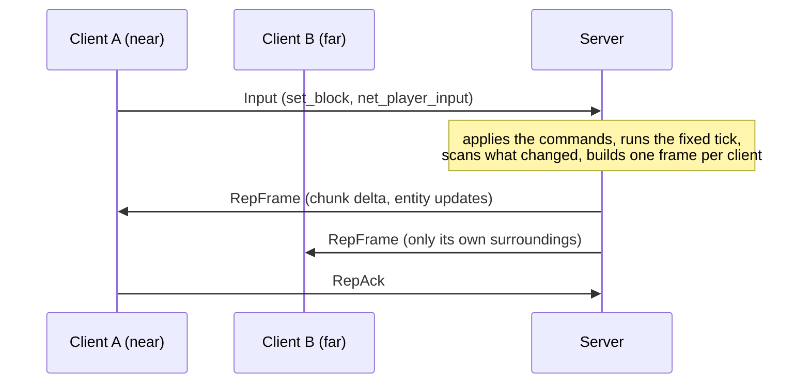

# Replication

Burrow multiplayer is **server-authoritative replication**: the server alone runs the simulation and streams to each
client the part of the state it needs, the chunks and entities around its player. There is one network model; every
way of playing online (`burrow serve`, `burrow-server`, the lobby, the editor's host session, join links)
uses it. The shared parts (transports, handshake, authentication, identity, whitelist, rate limits) are described in
[Networking](networking.md).

## Contents

* [The model](#the-model)
* [What runs where](#what-runs-where)
* [Interest management](#interest-management)
* [Replicated state](#replicated-state)
* [Component visibility](#component-visibility)
* [Dedicated server saves](#dedicated-server-saves)
* [Protocol](#protocol)
* [Bandwidth budget](#bandwidth-budget)
* [Client inputs, prediction and reconciliation](#client-inputs-prediction-and-reconciliation)
* [Proximity chat](#proximity-chat)
* [Using the API](#using-the-api)
* [Security](#security)
* [Limits](#limits)
* [Measurements](#measurements)
* [How it is tested](#how-it-is-tested)
* [What is not covered](#what-is-not-covered)

## The model



* The server is authoritative. It applies the clients' commands (the whitelist of [Networking](networking.md)) and runs every fixed
  system: scripts, physics, water, block logic, weather.
* After every tick it scans the simulation once (`tracker`): each overlay chunk, each component value of each entity
  and each replicated extra state gets a version that changes with its content.
* For every client it compares those versions with what that client holds and builds one **frame** of what changed
  inside the client's interest, nearest first, within the client's bandwidth budget.
* The client writes the frame into its copy of the simulation and runs only frame stages on it.

Nothing is deterministic on the client side and nothing has to be: the client never steps its simulation, its
`StateHash` and journal are meaningless, there is no desync and no resync.

## What runs where

| | server | client |
|---|---|---|
| fixed systems (scripts, physics, water, block logic, weather) | yes | no (the app is in manual step mode and never calls `StepFixed`) |
| frame stages (input, UI, audio, particles, rendering, the voxel streamer and mesher) | yes (headless: no window) | yes, on the replicated copy |
| command validation (whitelist, rate limits, the commands' own checks) | yes | no |
| base terrain generation | yes | yes (same seed and generator, pinned) |
| overlay chunks (edits) | owner | copy, within the view distance |
| entities and components | owner | copy, within the view distance |
| local prediction | no | yes (frame domain) |

The base terrain is never sent: both sides generate it from the pinned seed and generator. Only the overlay (the
chunks edited since the world was generated, which is what a snapshot stores) is replicated.

The voxel streamer remeshes on the client exactly as after a local edit: `App.ApplyReplica` sends a
`CommandsApplied` event after every frame and the mesher compares chunk versions.

## Interest management

Each client has an **interest center**, in voxels. The authoritative position comes first:

1. `replica.ServerConfig.PlayerPos(engine, player)`, the game's own rule;
2. the player's **avatar**: the entity named `avatar_<player id>` (`scene.name`) or tagged `avatar_<player id>` or
   `player:<player id>` (`tags`), lowest entity index first (`replica.FindAvatar`). The `multiplayer` template's
   avatars script names and tags its avatars so: its servers are authoritative out of the box.

Only when the game declares neither does the server use the view the client reports (`RepView`, the camera
position; `netplay` sends the voxel streamer's focus). That view moves at most `ViewSpeed` voxels per second (128) from
the last accepted position and is held within `ViewLeash` voxels (256) of the player's last authoritative position, or
else of its registry spawn point (`net_player_spawn`). Without any of them it is only speed limited; without a view,
the center is the spawn point, else the origin. A game without avatars that wants the leash calls `net_player_spawn`.

The interest is the chunks within `View` chunks horizontally (a disc, default 8, at most 32) and `Vertical` chunks
vertically (default 4) of the center's chunk, and the entities and fine water inside. Leaving uses one chunk of
hysteresis so a player walking on a border does not make chunks flicker.

## Replicated state

What is replicated is a registry of names (`replica.Policy`); what is not listed is server-only.

* **Components**: every registered component except those in `Policy.ServerOnly` (the default keeps `script`,
  `script.input` on the server: clients do not run scripts, and script `State` is private; see
  [Component visibility](#component-visibility)). A
  component travels through its snapshot encoding (JSON), unless it has a **codec**: then, while the rest of the
  value (its cold part) is unchanged, only its hot fields travel, quantized, as a per-field delta against the value the
  client holds. See [Component codecs](#component-codecs).
* **Extra states** (`sim.Extra`): only those in `Policy.Extras`, each with a check interval and an optional encoder.
  The default replicates the player registry `net.players` through `netsim.PublicState` (the registry without the
  players' inputs, so it changes on joins, leaves and spawns, not on every input), the lobby `net.lobby` and the
  `weather`. Fluid state, block logic, animation libraries and the engine's fixed resources stay on the server.
* **Fine water** (`fluid.Config.Fine`, `runtime.plugins.fine_water`): the bricks of sub-cell water, which live in the
  fluid state outside the chunks. The server exports them once per tick, groups them by chunk and versions each chunk;
  a client receives the chunks of its interest whole, then as brick deltas (the bricks that changed and the cells that
  lost theirs), under the same budget as the voxels, and drops them when they leave its interest. The client draws
  them through its own `voxel.FineSource`, which the voxel streamer meshes like local fine water. A chunk keeps its last
  64 deltas, and a client that missed versions gets them merged into one delta (the whole chunk only past that history).
  Falling streams (`FineGrid.Streams`) are sent as a list: a frame carries `StreamsSet` and the whole list of the streams
  whose lip is in the client's range (256 at most) when it changed, judged like the streamer's re-mesh (position, which
  sub-columns flow, the debit in quarter octaves, the gaps in 64ths), so a steady cascade is not resent; the client's
  fine source exports them with its bricks and the cascade is drawn as on the server.
* **Chunks**: the overlay chunks, sent whole on enter (deflate of `voxel.Chunk.MarshalBinary`, compressed once per
  version and shared by every client) and then as per-edit deltas (the voxels that changed between the version a
  client holds and the new one; more than 1024 edits and the whole chunk is cheaper). A removed overlay chunk is sent
  as *base*: the client shows the generated terrain again.

### Component codecs

`replica.RegisterCodec(name, replica.NewCodec[T](version, fields, hot, set))` gives a component a compact binary form:
`hot` quantizes its hot fields into at most 64 integers, `set` writes them back; the rest of the value is its cold
part. When the cold part changes the value travels as JSON followed by its hot fields whole (the baseline); otherwise
only the hot fields travel, whole (`CompFull`, zigzag varints) or as a delta from the version the client holds
(`CompDelta`: a varint mask of the changed fields, then their differences). The codec versions are announced in
`RepSchema` and must match on the client. Built in:

| component | hot fields | quantization |
|---|---|---|
| `transform` | position, Euler rotation, scale (9) | 1/256 voxel, 1/100 degree, 1/1024 |
| `physics3d.rigidbody` | position, rotation, velocity, angular velocity, sleeping (14) | 1/256 voxel, smallest-three quaternion (15 bits per component), 1/256 voxel/s, 1/1024 rad/s |

A walking entity costs a few bytes per tick instead of about 70 bytes of JSON. `Policy.NoCodecs` sends JSON only.

Versions are per item, not per client: one scan per tick, shared encodings, and per client only a version number per
held chunk and entity. A component changes when its `HashBytes` changes (the same encoding as the state hash).

## Component visibility

Clients do not run scripts, so a game's **script `State`** (the `script` component) never reaches them. Anything a
client must show or read (inventory, furnace contents, skills, health) must live in a **component**, written by the
script or a native system and replicated. Rule of thumb: *keep client-visible state in components, not in script State.*

By default a replicated component goes to every client that holds the entity. A game narrows that per component with a
**visibility rule**:

| rule | who receives the value |
|---|---|
| `VisAll` (default) | every client that holds the entity |
| `replica.Owner` (`VisOwner`) | only the player that owns the entity |
| `replica.Nearby(r)` (`VisNearby`) | only clients whose interest center is within `r` voxels of the entity |

```go nocheck
// next to the registration of the component, in the plugin that owns it (server and clients alike)
sim.RegisterComponent[Inventory](e, "game.inventory")
replica.RegisterVisibility("game.inventory", replica.Owner)
replica.RegisterVisibility("game.nameplate", replica.Nearby(24))

// or per server: replica.ServerConfig{Policy: &replica.Policy{Visibility: map[string]replica.Visibility{...}}}
```

The **owner** of an entity is the player named by the entity itself: a node named `avatar_<id>`, or an entity tagged
`avatar_<id>`, `player:<id>` or `owner:<id>` (`tags`). Put the inventory component on the player's avatar, or tag a pet,
a chest or a furnace `owner:<id>`. An entity with no owner is owned by nobody, so an owner-only component on it is sent
to no client.

* The entity and its other components stay visible to everyone in range; only the restricted component is withheld.
  Restricted values are never sent, so a modified client cannot read them.
* Visibility is re-evaluated every tick even when no value changes: a client that comes within `r` voxels, or an entity
  that changes owner, makes the server send the whole value; a client that moves away or loses the entity gets the
  component removed.
* The component is whole in the simulation and the saves: the rule changes the replication only.
* A script keeps its working data in `State` if it likes, but must write what clients show into the component each
  time it changes.

## Dedicated server saves

A dedicated server restores its saved world on start. When the game changed since the save:

* a component the game gained is added **empty**, with a log line (always safe);
* a component the game **lost** (removed or renamed) would lose data: the server refuses to start and names each
  component with its number of values (`the saved world holds component data the game no longer has: game.mana (14
  values)`). Restore the previous name, set `"migrate": true` in `server.json` to drop that data (the previous save
  stays in `world/backups`), or move the `world` directory away for a new world;
* a plugin turned on or off (lobby, weather, fluid: a fixed resource state) cannot be converted; the error names it.

## Protocol

The replicated model uses the transports and the handshake of [Networking](networking.md#protocol) unchanged (Hello,
Challenge, Auth, Welcome, Reject, Ping, Pong, Chat, ChatMsg, Kick, Bye, Input), protocol version 4. The Challenge flag
`4` (`FlagReplicated`) announces the model. After the Welcome (whose snapshot fields are unused) the server sends one
`RepSchema`, then one `RepFrame` (or `RepFrameZ`) after every tick.

`sv` is a zigzag varint (minimal encoding), `pos` three `sv` chunk coordinates within ±2^26.

| type | name | direction | fields |
|---|---|---|---|
| `0x70` | RepSchema | S→C | `uv` tick length (µs), `u8` view, `u8` vertical, `uv` count (≤256) of component names, `uv` count (≤64) of extra names (`str` ≤64 printable ASCII, unique), `uv` count of codecs, each `uv` component index (increasing) and `u8` codec version |
| `0x71` | RepFrame | S→C | `uv` seq (from 1, +1 per frame), `uv` server tick, `uv` input ack, leaves (`uv` count ≤4096, `pos` each), chunks (`uv` count ≤4096, then `pos`, `uv` version, `u8` kind: 0 full + `bytes` ≤128 KiB, 1 delta + `uv` from version + `uv` count ≤4096 of (`uv` index ≤32767, `uv` block ≤65535), 2 base), despawns (`uv` count ≤8192, `uv` entity), entities (`uv` count ≤8192, then `uv` entity, `uv` count ≤256 of (`uv` component index, `u8` encoding: 0 JSON, 1 hot fields whole, 2 hot fields delta, `bytes` ≤64 KiB), `uv` count ≤256 of removed component indexes), extras (`uv` count ≤64 of (`uv` index, `bytes` ≤512 KiB)), fine water (`uv` count ≤1024, then `pos`, `uv` version, `u8` kind: 0 full, 1 delta, 2 drop; for 0 and 1 `u8` N (2, 4 or 8), for 1 `uv` from version, `uv` count ≤4096 of (`uv` cell ≤32767, N³ fill bytes ≤32), for 1 `uv` count ≤4096 of removed cells) |
| `0x72` | RepAck | C→S | `uv` last frame applied |
| `0x73` | RepView | C→S | three `sv` camera coordinates in thousandths of a voxel (±2^40) |
| `0x74` | RepFrameZ | S→C | `uv` raw size (≤1 MiB), `bytes` deflate of a whole RepFrame message (type byte included) |
| `0x80` | VoiceUp | C→S | `bytes` voice frame (1..256) |
| `0x81` | VoiceDown | S→C | `uv` speaker, `bytes` voice frame (1..256) |
| `0x82` | VoiceBlock | C→S | `uv` player, `bool` blocked |

The voice messages are shared with the other messages ([Networking](networking.md#protocol), [Voice chat](voice.md#network)):
the replicated server routes them on the interest centers and never lets them into a frame or the bandwidth budget.

An entity is its 64-bit ECS handle (slot index and generation); the client mirrors the server's ids
(`ecs.World.Revive`), so references between components stay valid. Within a frame, leaves and despawns apply first,
then chunks, entity updates (an update of an unknown entity spawns it) and extras. The server keeps every frame under
960 KiB and compresses it (`RepFrameZ`) when that is smaller; JSON components compress about 3.5 times.

Frames ride the reliable, ordered stream: a delta is computed against the version the server last sent to that
client, which the client is guaranteed to have applied before the next frame. The acknowledgements are flow control:
the server pauses a client's stream (it sends nothing and keeps the pending work) while `MaxUnacked` frames (40, two
seconds) are unacknowledged or its send window is full, and resumes with the current state, not a backlog.

## Bandwidth budget

Every client has a token bucket of `BytesPerSecond` (256 KiB/s by default, burst half a second) on the bytes actually
sent (compression is refunded). Each tick the server sorts the pending items of a client and adds them until the
budget or the frame size is spent; the rest waits:

* entities without a position first, then by distance to the interest center; an entity update that has waited
  `age` ticks has its distance divided by `1 + age²`, so under a saturated budget far entities still move, less often;
* chunks and fine water chunks by distance (the chunk under the player first).

Deltas and leaves are small; extra states are sent outside the budget (they are few and checked at most once per
interval). A client never holds more than `MaxEntities` entities (2048).

## Client inputs, prediction and reconciliation

Clients send `Input` messages with the whitelist (`net_player_input`, `set_block`,
`fill_box`, `fill_sphere`, `block_use`, `gameui_event`, the `lobby_*` kinds) and rate limits; the target tick is
ignored. The server applies at most `MaxCmdsPerTick` commands per player per tick, in order, before the tick; server-only
kinds (`net_player_join`, `net_player_leave`, `net_player_spawn`) are refused.

Every frame carries the sequence number of the last `Input` the server applied for that client. The client keeps its
sent commands in a prediction ring (`netbase.Pending`) and `replica.ClientConfig.OnReconcile(tick, pending)`
runs after every frame with the commands still unapplied.

### Smoothing and prediction

`replica.Smoother` (installed by `netplay` for a replicated guest; `GuestOptions.NoSmoothing` turns it off) works in
the frame domain only: a PostUpdate system after `scene.hierarchy` recomputes the world transforms over
`replica.SmoothNodes` (the replicated node tree with overriding local transforms). The replicated simulation is never
written, so what the server sends stays exact.

* **Remote entities** are drawn `Delay` (100 ms, `GuestOptions.InterpDelay`) behind a smoothed estimate of the server
  clock (the frames' arrival times, filtered so jitter does not show), interpolated between the two replicated
  transforms around that time (positions and scales linearly, angles along the shortest arc). Past the newest sample,
  when frames are late, the motion is extrapolated for at most `MaxExtrapolate` (250 ms), then held.
* **The local avatar** (`FindAvatar` of the local player) is predicted: the unacknowledged inputs are replayed with a
  `PredictFunc` on top of the replicated avatar after every frame. The misprediction is the prediction made for the
  last input the server applied minus where the server actually put the avatar: a correct prediction gives no
  correction whatever the latency; an error is blended away over `Correction` (100 ms) and snapped beyond `Snap`
  (4 voxels: a teleport). The server's movement code runs in its scripts (WebAssembly in the simulation), which the
  frame domain cannot call, so the game provides the `PredictFunc` (`GuestOptions.Predict`); the default,
  `replica.TemplatePredict`, mirrors the walk of the `multiplayer` template's avatars script (4.317 voxels per second
  along the input yaw, ×1.3 with the sprint button 21). Vertical motion (gravity, jumps, steps) is left to the
  corrections.

* **Movement authority** (`net/netsim/authority.go`, as Minecraft): a predicting client claims its position with every input
  (`netsim.WithClaim`: feet, vertical speed, and the server teleport count it follows). The server takes the claim when it
  passes its checks (speed budget over time, climb without support, vertical speed, the body box swept against the blocks)
  and walks the input itself otherwise, counting a teleport (`netsim.Player.TP`, replicated). A node moved by a rule between
  two inputs counts one too. The client corrects only when the teleport count changes; a correct prediction is never rolled
  back, whatever the latency or the small differences of the replicated world.

* **Root-motion dashes** are predicted by wrapping the predictor: `replica.RootPredict(base, root)` runs `base`, then adds
  the local-space velocity returned by the `RootFunc` for that input step (a clip's `root.move` sampled at a time the
  game derives from the input), rotated by the input yaw exactly as the animation system does; `ok == false` leaves the
  step to `base`.

## Proximity chat

`runtime.proximity_chat` (a radius in voxels; `HostOptions.ChatRange`) makes chat local: a player's line reaches only
the players within that distance, measured between interest centers (`replica.ServerConfig.ChatRange`). Lines of the
server reach everyone, the sender always gets its own line, and the host's chat log (`OnChat`) sees every line. The
server also takes a generic `ChatFilter(from, to)` hook. This is text chat; voice chat uses the same server-side positions
([Voice chat](voice.md#network)).

## Using the API

```go nocheck
// server (a dedicated server, or a listen server polled from the game loop)
srv, err := replica.NewServer(replica.ServerConfig{Sim: &netapp.AppSim{A: app}, Listener: ln, Pins: pins, Password: key,
	Whitelist: netplay.WhitelistFor(), View: 8, BytesPerSecond: 256 << 10})
for { srv.Poll(time.Now()); app.Frame(dt) }

// client
c, err := replica.Connect(ctx, addr, netbase.ConnectOptions{Fingerprint: fp}, replica.ClientConfig{Target: app, Pins: pins, Name: "ana"})
for { c.SetView(camX, camY, camZ); c.Poll(time.Now()); app.Frame(dt) }
```

`internal/netplay` does all of this: `Host.Srv` is the `netplay.Server` interface (the host API of `*replica.Server`:
`Submit`, `SubmitAs`, `AddLocalPlayer`, `Kick`, `Chat`, `Peers`, `Tick`, `Close`), `Guest.Client` the `*replica.Client`.
The hooks of the dedicated server (`AllowConnect`, `AllowJoin`, `PlayerID`, `RequireIdentity`, `OnPlayerJoin`) are
`HostOptions` fields. `replica.Server.Metrics` and `Clients` report the scan size and time, chunk and entity counts and the
frame bytes of every client.

## Security

The threat model is that of [Networking](networking.md#security-and-threat-model): clients are hostile, the server
is trusted. The handshake, the authentication lockout, the identity, the whitelist, the per-kind command rates, the
message and byte rates and the violation budget are the shared code of `net/gate`. Specific to this model:

* **Information.** A client receives only its interest: it cannot see chunks, entities or fine water beyond its view
  distance (no wallhack beyond it, no world download). With an authoritative position (`PlayerPos` or an avatar) the
  center is the server's and the client's view is ignored; a client-reported view moves at `ViewSpeed` at most and stays
  within `ViewLeash` of the player's authoritative or spawn position. Server-only components and extra states are never
  sent.
* **Forged acknowledgements.** An ack beyond the last frame sent or going backwards is a violation; too many kick the
  client. Acks only gate the stream, so a lying client can only slow its own stream down.
* **Floods.** Inputs, views, acks and chat are counted by the message and byte buckets; commands by the whitelist
  rates; pending commands are bounded per client.
* **Memory per client** is bounded: held chunks by the view distance, entities by `MaxEntities`, pending commands by
  `MaxPendingCmds`, queued bytes by the transport's send window (the stream pauses instead of queuing).
* **Hostile server** (client side): decoders are strict and bounded (fuzzed), inflation is bounded (a chunk to
  70 KiB, a frame to its announced size within 1 MiB), block ids are checked against the registry, entity slots
  against `ecs.MaxReviveIndex` (4 Mi), the entity count against `ClientConfig.MaxEntities`; a frame that contradicts
  what the client holds (a delta from another version, a leave of an unknown chunk) ends the session.

## Limits

| limit | default | where |
|---|---|---|
| players connected (plus those within their reconnect grace) | 256, at most 1024 | `ServerConfig.MaxPlayers` |
| player registry records | 4096 | `netsim.MaxRecords` |
| view distance | 8 chunks (at most 32), vertical 4 | `View`, `Vertical` |
| bandwidth per client | 256 KiB/s | `BytesPerSecond` |
| entities held by one client | 2048 | `MaxEntities` |
| unacknowledged frames before pausing | 40 | `MaxUnacked` |
| send window before pausing | 2 MiB | `SendWindow` |
| client view speed | 128 voxels/s | `ViewSpeed` |
| client view distance from the authoritative or spawn position | 256 voxels | `ViewLeash` |
| frame workers | GOMAXPROCS | `Workers` |
| fine water chunks in a frame, bricks per chunk | 1024, 4096 | `wire.MaxFineChunks`, `wire.MaxFineBricks` |
| voxel edits of one delta | 1024 | `MaxDeltaEdits` |
| frame | 960 KiB | `wire.MaxRepFrameSize` |
| one component value | 64 KiB | `wire.MaxCompData` |
| one extra state | 512 KiB | `wire.MaxExtraData` |
| handshakes in progress | 128 (4 per address group) | `MaxHandshakes`, `MaxHandshakesPerIP` |

The other limits (rates, timeouts, reconnect grace) are those of the shared limits table in [Networking](networking.md#limits).

## Measurements

`go test ./net/replica -run TestBandwidthReport -v` and `go test ./net/replica -bench BytesPerClient -benchtime 1x`
on an Apple M2 Max (12 cores), 20 ticks per second, clients walking over a 512×512 area with edits every half second and
mobs whose transform changes every tick. "Before" is the first version (JSON components, frames built on the server
loop), "after" the current one (component codecs, frames built in parallel):

| scenario | bytes/client/s before | after | server tick before | after |
|---|---|---|---|---|
| 8 clients, 200 mobs, view 4 | 13.5 KB/s (max 20 KB/s) | 4.6 KB/s (max 6.2 KB/s) | 0.4 ms | 0.35 ms |
| 16 clients, 500 mobs, view 8 | 99 KB/s (max 141 KB/s) | 28.7 KB/s (max 39.8 KB/s) | 2.8 ms | 1.0 ms |
| 64 clients, 500 mobs, view 8 | 99 KB/s (max 146 KB/s) | 28.8 KB/s (max 41.1 KB/s) | 9.4 ms | 1.8 ms |
| 256 clients, 500 mobs, view 8 | 93 KB/s (max 146 KB/s) | 27.2 KB/s (max 41.1 KB/s) | 33.7 ms | 4.4 to 4.8 ms |

A view of 8 chunks over that area holds about 390 mobs that all move every tick: the stream is dominated by their
transforms, now about 4 bytes of position delta each instead of 70 bytes of JSON. A quiet world (8 walking clients and
an edit every half second, no mobs) costs about 235 bytes per client per second.

Capacity at 20 ticks per second (a 50 ms tick): the first version spent 0.13 ms per client per tick on one core, about
380 clients per server. With codecs the serial cost is 0.11 ms per client (`Workers: 1`: 27.7 ms for 256 clients),
about 460 clients per core; with 12 workers 256 clients take 4.8 ms, about 2600 clients per server within the tick
(about 220 per core: the scan, the views and the sends stay serial). The scan itself costs 0.06 to 0.6 ms per tick
here (a codec component's cold part is hashed when its value changes).

## How it is tested

* `net/wire`: round trip, golden bytes, limits and the decoder fuzz target cover the replicated messages, the codec
  encodings and the fine water entries.
* `net/replica`: chunks enter, leave, deltas and removal; entities enter, leave, single-component updates (binary) and
  death; the registry without inputs; the budget (bytes over two seconds within the budget, nearest first, everything
  arrives eventually); inputs applied and the prediction ring confirmed; reconnect with the same player; frames
  identical with 1 and 8 workers (`TestParallelFramesDeterministic`, every byte on the network); the codecs
  (smallest-three quaternions within 0.0002 rad, field deltas); fine water replicated under interest with brick deltas;
  interpolation (midpoints, shortest arc, capped extrapolation, held entities), reconciliation with 0 to 7 ticks of
  latency (no correction on a steady walk, a snap on a teleport) and the render overrides that leave the simulation
  untouched; proximity chat; hostile clients (forged acks, ack floods, input floods, forbidden commands, malformed and
  server-only messages, view teleport, view walking away from its leash, an avatar overriding the view); a fuzz
  target that feeds arbitrary frames (binary components, fine water) to a client; a 64-client soak (`-tags slow`) and
  the bandwidth benchmark. The package runs under `-race` (the parallel frames).
* `internal/netplay`: a dedicated replicated server built from the sandbox template with three guests over loopback
  TLS: only the near guests receive an edit, moving reveals it, a lost connection resumes with the same player and its state, the smoothing system is installed.
* Component visibility (owner-only, nearby, entering and leaving the radius) is tested in `net/replica`; the lobby and
  lobby mode and a restart from a save, including a game that gained or lost a component, in `internal/dedicated`.

## What is not covered

* **Vertical prediction.** The default predictor walks on the horizontal plane; jumps, gravity and steps come from
  the server's corrections (blended, or snapped beyond 4 voxels). A game with its own movement passes its own
  `PredictFunc`.
* **Interpolation of children.** Only replicated local transforms are interpolated; a parent's motion carries its
  children through the recomputed world transforms.
* **Unreliable transport.** Over TCP a delta against the last sent state is safe; a UDP transport would move the
  baseline to the last acknowledged frame (the acks already exist).
* **Serial parts.** The scan, the views, the reference counts and the sends stay on the server loop; beyond a few
  thousand clients they dominate.
