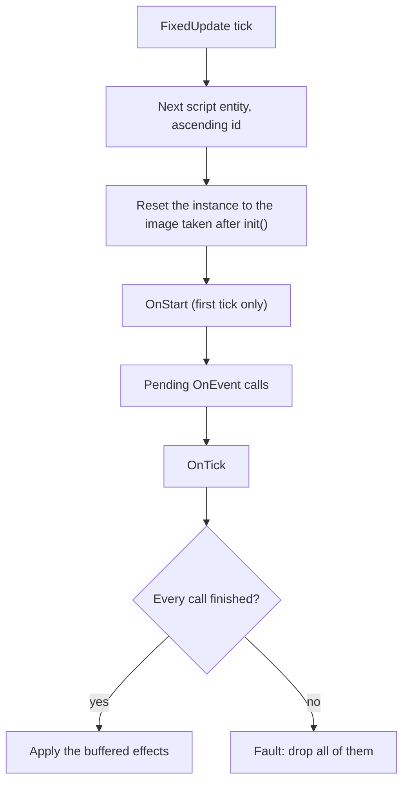

# Execution model

How and when the engine calls a script, what a call can see and change, and the rules that keep a script deterministic.

## The rules in short

* **Guest memory is not persistent** (unless you opt in to [`keep_memory`](#persistent-memory-keep_memory)). Before every call the instance is reset to the image taken right after `init()`. Globals, heap and stack do not survive. Persistent data lives in components ([Props and State](03-state-and-props.md)).
* **Calls happen only inside the fixed tick** (20 per second), one *transaction* per script node per tick.
* **Effects are buffered** and applied only if every call of the transaction finished. A fault drops them all.
* **Time is the tick.** `dt` is always 50 ms; there is no wall clock.
* **Reads see your own writes** inside a call (with the exceptions listed below).

## One tick

Details the chart leaves out:

* The system is `script.run`. With the physics plugin it runs before `physics.character`.
* **Order between nodes**: ascending entity index (the low 32 bits of the id), recomputed every tick. A node that reuses the slot of a deleted node runs early. Nodes that are `disabled`, have no module bound yet, or were spawned during this tick are not in the list (a node spawned by a script first runs on the next tick).
* **Order inside a transaction**: `OnStart` (if not started), then the inbox events in emission order, then due timers (as events, ordered by due tick then id), then `OnTick`. Each hook is a separate guest call with its own gas budget and a memory reset between calls; the budgets of [host calls and effects](09-errors-and-limits.md#budgets) are shared by the whole transaction.
* **Commit**: effects are applied in the order the script requested them, then State, subscriptions and timers are saved, then the next node runs. Node B therefore sees the committed voxels, components and spawns of node A in the same tick; A never sees B's.
* **Events and messages** sent during tick N reach `OnEvent` at tick N+1 or later, never in the same tick, even for a later node.
* **Input** is a journaled snapshot taken before the tick; every script sees the same values ([input, events and time](06-input-events-time.md)).
* A paused game or editor runs no ticks. Several ticks can run in one frame; the frame rate does not change what scripts see.

## 20 Hz scripts and smooth visuals

A script runs 20 times a second on purpose: the same ticks give the same result on every machine, in a replay and in multiplayer. It cannot run per frame.
What the player sees is still smooth:

* **Moved nodes are interpolated.** Meshes, sprites, voxel models and point lights are drawn between their previous and current tick by the frame's phase (`App.TickAlpha`), so a node a script moves 20 times a second glides at the screen rate. A teleport (more than 8 blocks), a new node and a gap of ticks are drawn as they are. Frame domain only: scripts, physics and the hash see the real 20 Hz value. `engine.NodeInterp.Off` turns it off.
* **Per-frame behaviour is data, not script.** Use the frame-domain components: `visual.spring`, `visual.sway` and `visual.bind` ([frame visuals](../visual-effects.md)), `render.viewattach` (held items), `character` (`fp_*`, `held_model`), `camera_rig` (follow, smooth, shake), animation clips and tracks, particles, `audio_source`. A script starts them (`CameraSwitch`, `AnimPlay`, `Emit`...); the engine plays them every frame.
* **Do not read frame-rate values in a script** (mouse look, camera pose between ticks): input is a snapshot per tick, so a script that must feel instant (an aim reticle, a cursor) belongs to the game UI (`game.ui`), which runs per frame.

## Reads and writes inside a call

| Operation | Takes effect | Visible to the same call | Visible to other scripts |
|---|---|---|---|
| `Set`, `SetRaw`, field setters, `Patch`, `Remove` | at commit | yes (`Get`, `Has`, field getters) | after commit |
| `SetTransform` | at commit | yes (`GetTransform`, `Get(...,"transform")`) | after commit |
| `SetVoxel` | at commit | yes (`Voxel`, `Raycast`) | after commit |
| `Spawn` | node appears at commit | the handle works for `Set`, `SetTransform`, `Despawn`, `Get` | after commit |
| `Despawn` | at commit; runs `OnDestroy` of the subtree | `Exists`, `FindByName` report it gone | after commit |
| `SaveState` | persisted at commit | yes (`LoadState` returns it, also in later hooks of the transaction) | never (State is private to the node) |
| `Emit`, `Publish` | delivered at commit into the inboxes, handled on a later tick | | next tick |
| `After`, `Every`, `Subscribe`, `CancelTimer` | saved at commit | yes (`TimerRemaining`) | |
| audio, particles, camera, game UI, level and save requests | queued at commit as frame-domain requests | | |
| `SaveSet`, `SaveDelete` | at commit | `SaveGet` sees them | after commit |

Reads that do **not** reflect the call's own writes: `LightAt`, `PhysicsRaycast`, `PhysicsOverlap`, and the scene queries (`Parent`, `Children`, `ScenePath`, `FindWith`, `FindTag`, which read the committed scene only; nodes spawned by this call are absent). `FindByName` and `FindByPath` also read the committed scene.

`Voxel` and `SetVoxel` accept coordinates in `[-16777216, 16777216]` on each axis (`ERR_INVALID` outside) and block ids below `BlockCount()` (`ERR_INVALID` otherwise). A call that exceeds a budget returns `ERR_BUDGET` instead of trapping; once the per-transaction call budget is used up, almost every host call (including `Log` and `Voxel`) fails that way, see [budgets](09-errors-and-limits.md#budgets).

## Persistent memory (`keep_memory`)

Opt in for single-player games when ordinary Go code (package variables, maps, slices that live between ticks) must work. Project-wide: `"runtime": {"script_limits": {"keep_memory": true}}` in `vox.project`; or per node: `"keep_memory": true` in its `script` component.

* Each such node gets its own instance, never pooled or shared with other nodes. Its globals and heap are **not** reset between calls (OnStart, events, timers, OnTick, OnDestroy).
* `OnFrame` (the visual domain) keeps using a reset instance; it does not see these globals.
* Gas, host budgets and the memory cap are unchanged. Memory growth persists, so the 32 MiB cap (`memory_pages`) bounds the heap for good.
* **Fault**: the instance is discarded and recreated from the init image on the next call; the memory is lost (the fault is reported as usual).
* **Determinism**: same inputs give the same results, so replaying from tick 0 and `StateHash` runs still match.
* **Save and load**, snapshot restore and the editor hot reload drop every memory: scripts restart from the init image. Whatever must survive goes in `State`/components (`SaveState`).
* **Networked games refuse it** (`runtime.plugins.net`, `net_model: "replicated"`, dedicated server): guest memory can be neither restored nor sent to a late joiner. The project fails to load with an error.
* Native builds: globals already persist; `BURROW_NATIVE_DEBUG` skips the package-variable check for a module with a `keep_memory` script.

## Time

| API | Value |
|---|---|
| `Tick()` | Index of the current fixed tick. The first scripted tick of a new game is 1. Identical on every machine and in a replay. |
| `dt` of `OnTick` | `1 / rate` seconds: `0.05` at the default 20 Hz (the host passes `50` ms), `0.033`, `0.025` or `0.017` with `runtime.tick_rate` 30, 40 or 60. `burrowsdk.TickRate()` and `TickDt()` give it. |
| Duration in seconds | `ticks * TickDt()`. Keep durations as tick counts in State (`Tween`, `Cooldown`, `After`, `Every` do this for you). |
| WASI clock (`time.Now` in a Go script) | `tick * 50 ms + 1 us` per query. Monotonic and deterministic, but it measures ticks, not time. Do not use it. |
| `time.Sleep`, timers of the standard library | Nothing waits. Use `After` and `Every`. |

## Randomness

| API | Result |
|---|---|
| `Rand()` | Next `uint64` of the script's stream. |
| `RandFloat()` | `[0, 1)` from the top 53 bits of `Rand()`. |
| `RandN(n)` | `[0, n)`; `0` when `n <= 0`. |

The stream is a hash of (project seed, entity, tick, draw index). The draw index counts every `Rand*` call of the transaction, across `OnStart`, events, timers and `OnTick`, so an extra draw in one hook shifts only the later draws of the same node in the same tick. Adding or removing other scripts never shifts it, and it never consumes the shared simulation RNG. The seed is `runtime.seed` in `vox.project` (override: `burrowplay -seed N`). `rand_u64` is not a free call: it counts against the call budget.

`math/rand` and `crypto/rand` read the WASI `random_get`, a fixed stream seeded by the module hash: deterministic, but the same sequence every call (memory is reset) and unrelated to the project seed. Do not use them.

## Faults

A trap, a Go `panic`, `os.Exit`, gas exhaustion or out-of-memory fails the whole transaction:

* all buffered effects of the node's transaction are dropped; the node's State, inbox, timers and `started` flag stay as they were (the same events are delivered again next tick);
* `Log` lines the script wrote before the fault are still delivered;
* a `ScriptFault` event is sent, the node's fault counter goes up, and at 3 faults the node is disabled until its module changes;
* other nodes are unaffected, the engine never crashes.

Reasons, counters and how to read one: [errors and limits](09-errors-and-limits.md#faults).

## What is deterministic

The same project, seed, inputs and module bytes give the same `StateHash` ([determinism](../determinism.md)). The sandbox enforces most of it: no clock, entropy, files, network, threads or floating-point fusion (the WebAssembly spec forbids fused multiply-add, so Go's `math` is portable inside a guest), and gas is counted per instruction. What remains is your responsibility.

| Do | Do not |
|---|---|
| Keep time as ticks: `Tick()`, `After`, `Every`, `Tween`, `Cooldown` | Use `time.Now`, `time.Since`, `time.Sleep` |
| Draw randomness from `Rand`, `RandFloat`, `RandN` | Use `math/rand`, `crypto/rand`, a hand-seeded generator that is not part of State |
| Keep everything that must persist in State, Props or components | Keep it in package variables, closures, maps or slices that outlive a call |
| Iterate maps through sorted keys, or use slices | Rely on `range` order over a map |
| Keep floats finite; clamp before converting to an integer; let `SetTransform` reject NaN and Inf | Store NaN or Inf in State or components; use `CanonF32` when a value may be NaN |
| Run every effect through the SDK so it is buffered and journaled | Start goroutines, wait on channels, read files, environment variables or the network (they do not exist) |
| Store entity ids as `burrowsdk.Entity` or `uint64` | Round-trip entity ids through `float64` or `any` (they are 64-bit: slot index plus generation) |
| Re-read the world each tick, check `Exists` before using a saved entity | Assume a saved entity still exists (a stale id is not alive: its generation differs) |
| Pass the same `Config` limits when replaying | Change gas, memory, budgets or `MaxFaults` between recording and replay |

Do not print for debugging with `fmt.Println`: stdout and stderr are captured only for fault messages. Use `Log`/`Logf` ([debugging](10-debugging-and-testing.md)).

## Where scripts run

| Context | Behaviour |
|---|---|
| **Editor, edit mode** | Scripts do not run. A rebuilt `.wasm` is picked up about once a second: the module is re-registered and bound nodes are re-pinned (journaled `script_module_changed`), faults reset. |
| **Editor, Play** (Ctrl+Shift+P) | Scripts run in the editor's simulation. Keyboard and mouse go to the game's input map while the pointer is over the viewport. **Esc** or Stop restores the snapshot taken at Play: State, timers, faults and every edit made during play are discarded, and the `StateHash` after Stop equals the one before Play. The editor installs neither the level plugin nor the save plugin, so `LevelLoad`, `SaveSet` and `SaveSlot` fail with `ERR_UNAVAILABLE` there; run the project with `burrow run` to test them. Hot reload works. |
| **`burrow run` / `burrowplay` / exported game** | Same simulation. Modules are fixed at start: no hot reload. `runtime.plugins.scripts: true` (default off, required when scripts are listed) installs the plugin. |
| **Headless** (`burrow test`, `burrowplay -headless -ticks N`) | No window and no device input: `Action` returns `ok == false` unless the host queues an input snapshot. `burrow test` runs the project several times and requires an identical `StateHash` ([testing](10-debugging-and-testing.md#burrow-test)). |
| **Replay and journal** | The journal names each node's module by hash; replay re-executes the scripts with exactly those bytes. A runtime that lacks a module, runs under another `Config` fingerprint, or finds a data file (`ReadAsset`) whose content changed since recording fails the tick with an error (never a silent skip). |
| **Snapshot, undo, rollback, save games** | Every piece of script state is a component, so these are exact. A fixed tick that fails for any reason is rolled back by the engine, script effects and random draws included. |
| **Multiplayer** ([networking](../networking.md)) | Scripts run on every peer from the same commands ([multiplayer](08-multiplayer.md)). The local `script_set_input` snapshot is dropped: read the player registry instead (`NetPlayerCount`, `NetPlayerAt`, `NetPlayerInfo`). Binding is done from simulation state before every session tick, so a late joiner binds at the same tick; modules are pinned by the project content hash; hot reload is refused. |

## See also

* [Getting started](01-getting-started.md): hooks and registration.
* [State and props](03-state-and-props.md): what survives between calls.
* [Native scripts](15-native.md): the shipped game links scripts natively (no wasm reset, no gas): the same rules, enforced by a parity test.
* [Errors and limits](09-errors-and-limits.md): gas, budgets, faults.
* [Debugging and testing](10-debugging-and-testing.md): logs, profiling, `burrow test`.
* [Input, events and time](06-input-events-time.md), [multiplayer](08-multiplayer.md), [embedding and the ABI](12-embedding-and-abi.md).
* [Determinism](../determinism.md), [networking](../networking.md), [script/ABI.md](../../script/ABI.md).
